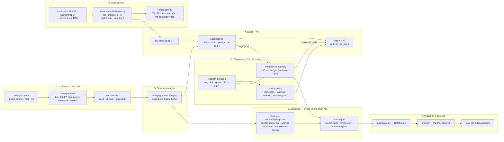
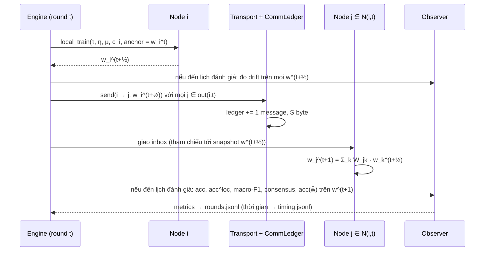

# Đề 2 — Kế hoạch, Quy trình & Kiến trúc hệ thống dự kiến

**Nghiên cứu thực nghiệm ảnh hưởng của dữ liệu Non-IID đến hiệu năng của Decentralized Federated Learning (DFL)**
PyTorch + torchvision + NetworkX · dataset MNIST (Fashion-MNIST để kiểm chứng lại)

| Mục | Nội dung |
|---|---|
| Phiên bản | 0.2 — bản đề xuất, chờ nhóm và GVHD duyệt (Gate G1) |
| Ngày | 2026-09-29 |
| Thay đổi so với 0.1 | Đã xử lý 27 phát hiện của 2 vòng phản biện đối kháng (doubt-driven): đo trước/sau bước tổng hợp; accuracy theo phân bố cục bộ; kiểm soát "lệch mục tiêu"; thuật toán chia theo NIID-Bench; μ của FedProx và quét τ; định nghĩa độ đo hội tụ và độ ổn định theo từng node; kiểm định H2; 5 seed cho thí nghiệm lõi; `code_version` theo nội dung code; chạy lại được lượt lỗi; thứ tự phụ thuộc giữa các task |
| Đầu vào | `docs/ĐỀ_TÀI_ĐỒ_ÁN_TỔNG_HỢP_HK261.pdf` (Đề 2) · `docs/đath1.docx` · `docs/research/*.pdf` · tra cứu bổ sung (§12) |
| Đi kèm | `docs/HANDOFF_GUIDELINE.md` (quy trình prompt từng pha) · `docs/spikes/spike_topology_partition.py` (tái tạo số liệu §3.2, §3.3, Phụ lục A) |
| Người đọc | Nhóm đồ án, GVHD; agent Claude Code chỉ đọc các mục (§) được chỉ định trong handoff |

---

## 0. Tóm tắt

- **Hướng PyTorch + torchvision + MNIST: ổn và nên giữ**, kèm 5 điều chỉnh (§1.1): thêm NetworkX và một lớp Transport tự viết để mô phỏng P2P; dùng mô hình nhỏ không BatchNorm; đo bằng các độ đo nhạy (bước/byte để đạt ngưỡng, consensus distance, accuracy theo phân bố cục bộ) vì MNIST có trần ~99%; kiểm chứng lại trên Fashion-MNIST; `torch.distributed` chỉ là tùy chọn.
- **Bản nháp `đath1.docx` đúng hướng về khái niệm nhưng chưa đủ để triển khai**: chiều của α bị ghi ngược, FedProx còn mô tả có Server, thiếu FedSGD và quantity skew, mục Kiến trúc/Framework/Dataset còn trống, chưa có thiết kế thí nghiệm, các độ đo chưa định nghĩa được bằng số (§1.2).
- **Hệ thống**: mô phỏng DFL đồng bộ, đơn tiến trình, truyền thông điệp (message-passing) có sổ cái đếm byte. Một vòng lặp Gossip-SGD duy nhất, tham số hóa bởi $(\tau, \mu)$, bao trọn D-PSGD (tương tự gần nhất của FedSGD), DFedAvg (FedAvg/gossip) và DFedProx (§3.4, §4).
- **Thực nghiệm**: 20 node; 8 mức dữ liệu (IID → Dirichlet α = 100 … 0.05 → #C = 2, #C = 1) cộng quantity skew; 4 topology chính (ring, Erdős–Rényi, random gossip, fully-connected); quét tần suất giao tiếp τ và độ mạnh prox μ ở cùng tổng số bước cục bộ; 5 seed cho thí nghiệm lõi. Khoảng **260 lượt chạy** (Tier 1 lõi 176 lượt ≈ 29 giờ-CPU, gồm đủ ba thuật toán đề yêu cầu; toàn bộ ≈ 44 giờ-CPU, hoặc 5–9 giờ GPU) (§3.7).
- **Điểm cần kiểm chứng chính**: *hiệu ứng tương tác Non-IID × topology* — ring suy giảm mạnh hơn fully-connected khi α nhỏ, đúng như lý thuyết dự đoán qua spectral gap (ring N = 20: 0.033; FC: 1.0), kiểm định bằng độ dốc của hiệu số ghép cặp theo mức Non-IID (H2, §3.8).
- **Hai bẫy đo lường đã được xử lý trong thiết kế**: (1) trên fully-connected, sau bước tổng hợp mọi node giữ cùng một model, nên "phương sai giữa node" phải đo cả trước tổng hợp và theo phân bố nhãn cục bộ; (2) với kích thước node lệch nhau, DFL (trọng số ngẫu nhiên kép) tối ưu một mục tiêu khác phân phối test, nên có thí nghiệm đối chứng FedAvg trọng số theo kích thước (§3.1, §3.6, E1c).
- **Quy trình**: 4 pha Discovery, Requirements & Design → Task Breakdown → Implementation & Testing → Code Review & Thẩm định; mỗi pha kết thúc bằng một gate do người duyệt (§6; prompt chi tiết ở HANDOFF).
- **Tiến độ**: 12 tuần, 7 mốc (M0–M6), 25 task nhỏ có tiêu chí chấp nhận (§7, §8).

---

## 1. Đánh giá hiện trạng

### 1.1 Hướng PyTorch + torchvision + MNIST

**Kết luận: đồng ý, đây là lựa chọn đúng cho đề này**, vì:

- Đề 2 là nghiên cứu *thực nghiệm có hệ thống*, nên cần kiểm soát hoàn toàn topology, trọng số trộn, thứ tự cập nhật và cách đếm chi phí. Một mô phỏng mỏng tự viết trên PyTorch cho quyền kiểm soát đó. Flower được thiết kế quanh server (ServerApp/ClientApp, strategy tổng hợp ở server), muốn chạy ring/gossip phải "bẻ" kiến trúc. Nhận định này của bản nháp (mục A.1) là đúng.
- torchvision cung cấp `torchvision.datasets.MNIST(root, train=True, transform=None, target_transform=None, download=False)` và `FashionMNIST` cùng giao diện, nên đổi dataset chỉ là đổi một tham số cấu hình.
- MNIST nhỏ (60k train / 10k test, 28×28): toàn bộ tensor nằm gọn trong RAM (~47 MB dạng uint8), đủ để chạy hàng trăm lượt thí nghiệm trên CPU.

**Cần 5 điều chỉnh** (đã đưa vào kiến trúc §4):

| # | Điều chỉnh | Lý do |
|---|---|---|
| 1 | PyTorch + torchvision chỉ là tầng học máy. Thêm **NetworkX** (topology) và lớp **Transport** tự viết (message-passing, sổ cái đếm message/byte) | Đề yêu cầu "hệ thống peer-to-peer" và đo "communication cost"; node chỉ được đọc thông điệp gửi tới mình |
| 2 | **Không dùng accuracy cuối làm độ đo duy nhất**. MNIST có trần ~99% nên khác biệt chỉ lộ rõ ở Non-IID mạnh → thêm bước/byte để đạt ngưỡng, consensus distance, drift, accuracy theo phân bố cục bộ | Tránh kết luận "không khác biệt" chỉ vì chạm trần |
| 3 | Thêm **Fashion-MNIST** để kiểm chứng lại (replication) các thí nghiệm lõi; CIFAR-10 để ở phần mở rộng | Đề gợi ý MNIST/Fashion-MNIST; tăng độ tin cậy mà không phải đổi code |
| 4 | Mô hình **SmallCNN 46,730 tham số, không BatchNorm** (cần chuẩn hóa thì dùng GroupNorm) | BatchNorm là nguồn lỗi đã biết khi học phi tập trung trên dữ liệu Non-IID (Hsieh et al., ICML 2020); mô hình nhỏ để chạy được trên CPU |
| 5 | **`torch.distributed` chỉ là tùy chọn** (backend gloo; tài liệu PyTorch 2.14 xác nhận gloo hỗ trợ `send`/`recv` trên CPU), dùng để demo đa tiến trình | Đề không yêu cầu đo độ trễ; chi phí giao tiếp đo bằng số message × kích thước model. Câu hỏi trong bản nháp "có bắt buộc đa tiến trình không?" → trả lời: **không**, nhưng cần GVHD xác nhận (Q1, §11) |

So sánh nhanh các lựa chọn framework (chi tiết ở ADR-001, §10):

| Lựa chọn | Ưu | Nhược với Đề 2 | Kết luận |
|---|---|---|---|
| **PyTorch + NetworkX tự viết** | Kiểm soát hoàn toàn topology, trọng số, cách đếm byte; nhỏ (ước tính 1.5–2.5k dòng); dễ debug; nhanh | Phải tự viết và tự kiểm thử (có bộ test bất biến §5.2) | ✅ Chọn |
| Flower (flwr 1.30) | Hệ sinh thái lớn, có baseline NIID-Bench | Kiến trúc xoay quanh server; P2P phải tự "hack" (flwr-serverless, GLow là các nỗ lực bên ngoài) | ❌ |
| p2pfl / NEBULA (Fedstellar) / DecentralizePy | Có sẵn P2P thật (gRPC/socket) và topology | Nặng (Docker/đa tiến trình), khó kiểm soát chính xác thứ tự và cách đo; tốn thời gian học công cụ | Chỉ tham khảo, có thể dùng đối chiếu kết quả |
| gossipy | Mô phỏng gossip learning bằng Python | Kém linh hoạt cho D-PSGD/FedProx đồng bộ | Chỉ tham khảo |
| gRPC/ZeroMQ tự viết | P2P thật | Tốn công, không phục vụ câu hỏi nghiên cứu | ❌ |

Phiên bản (kiểm tra PyPI ngày 2026-09-29): torch 2.14.0, torchvision 0.29.0, flwr 1.30.0. Tài liệu NetworkX hiện hành là 3.7, nhưng trên Python 3.10 pip chỉ cài được 3.4.2 → **khuyến nghị Python 3.12** (§4.8).

### 1.2 Đánh giá bản nháp `đath1.docx`

**Điểm tốt, nên giữ:**
- Định nghĩa DFL và Non-IID đúng tinh thần đề.
- Công thức gossip $w_i^{t+\frac12}=\sum_{j\in N(i,t)\cup\{i\}} p_{ij}\, w_j^t$ với $p_{ij}\ge 0,\ \sum_j p_{ij}=1$ là đúng, và ký hiệu $N(i,t)$ đã cho phép topology thay đổi theo thời gian.
- Hàm mục tiêu FedProx $h_k(w;w^t)=F_k(w)+\frac{\mu}{2}\|w-w^t\|^2$ và khái niệm γ-inexact đúng.
- Mô tả pathological partition đúng.
- Phân tích framework hợp lý: Flower khó làm P2P, PyTorch + NetworkX dễ làm.
- Mục tiêu tổng ("càng lệch thì tệ đi bao nhiêu, topology nào chịu tốt nhất") bám sát đề.

**Lỗi và thiếu sót cần sửa.** Mức: 🔴 nghiêm trọng (sai kiến thức hoặc thiếu yêu cầu bắt buộc) · 🟠 quan trọng (chưa đo hoặc chưa triển khai được) · 🟡 nhỏ.

| ID | Mức | Vị trí trong bản nháp | Vấn đề | Cách sửa |
|---|---|---|---|---|
| D1 | 🔴 | "Phân phối dữ liệu" và 3.2 (lặp 2 lần) | "Tham số α càng lớn, dữ liệu phân mảnh càng lớn (NonIID)" là **sai chiều**. Đúng: α → 0 thì mỗi node dồn vào rất ít lớp (Non-IID cực đoan); α → ∞ thì gần IID. Chính đề bài ghi "α nhỏ → Non-IID mạnh" | Sửa câu; minh họa bằng bảng §3.2 (α = 100: 10 lớp/node, JS ≈ 0.002; α = 0.1: ~2.5 lớp/node, JS ≈ 0.55) |
| D2 | 🔴 | 3.2 Dirichlet | Mới là định nghĩa phân phối Dirichlet, **chưa phải thuật toán chia dữ liệu**. Chưa nói lấy mẫu $p_k\sim\mathrm{Dir}_N(\alpha)$ *theo từng lớp qua các node* (kiểu NIID-Bench, có bước "balance") hay *theo từng node qua các lớp* (Hsu 2019); chưa có ràng buộc số mẫu tối thiểu và seed | Dùng thuật toán P1 ở §3.2 |
| D3 | 🔴 | 2.2 FedProx | Cả quy trình mô tả **có Server** (Server khởi tạo, chọn tập $S_t$, gửi về Server, Server tổng hợp), mâu thuẫn với DFL | Viết lại dạng phi tập trung: mỏ neo (anchor) của số hạng proximal là model của chính node ở đầu round, tức kết quả tổng hợp láng giềng của round trước (§3.4) |
| D4 | 🔴 | 2. Thuật toán | **Thiếu FedSGD** (đề yêu cầu FedAvg/Gossip, FedSGD, FedProx). DFedAvg (FedAvg phi tập trung) chưa được định nghĩa tường minh | D-PSGD (Lian 2017) là tương tự phi tập trung gần nhất của FedSGD ($\tau = 1$, một bước gradient mỗi lần giao tiếp); DFedAvg dùng $\tau$ bước cục bộ (§3.4) |
| D5 | 🔴 | 3.2 | **Thiếu quantity-based skew** (đề yêu cầu) | Thêm P3: $q\sim\mathrm{Dir}_N(\beta)$, nhãn IID (§3.2) |
| D6 | 🔴 | 4, 5.1, B | Mục **"Kiến trúc hệ thống" trống** (đề yêu cầu "vẽ lại kiến trúc tổng quan"); "5.1 Framework" và "B. Dataset" cũng trống | Dùng §4.1–§4.3 |
| D7 | 🔴 | Toàn văn | **Chưa có thiết kế thí nghiệm**: số node, số round, số bước cục bộ, lr, batch, seed, baseline (tập trung / chỉ cục bộ), biến cố định và biến thay đổi, giả thuyết | §2.3, §3.5, §3.7 |
| D8 | 🟠 | "Độ chính xác mô hình (F1-score)" | Gọi F1 là "độ chính xác"; công thức chỉ cho bài toán **nhị phân** trong khi MNIST có 10 lớp | Báo cáo riêng *accuracy* và *macro-F1*; macro-F1 là trung bình F1 của 10 lớp (§3.6) |
| D9 | 🟠 | Tốc độ hội tụ | "Đạt mức mục tiêu và đi ngang" chưa đo được | Số bước/round/byte để đạt ngưỡng $R@x$ (x = 90/95%), có điều kiện "đạt bền vững", nội suy và quy tắc cho seed không đạt; AUC của learning curve (§3.6) |
| D10 | 🟠 | Độ ổn định | "Đường đi lên mượt mà" chỉ là định tính | Độ dao động (std của hiệu số liên tiếp), mức sụt lớn nhất, độ lệch giữa các seed, consensus distance (§3.6) |
| D11 | 🟠 | Chi phí giao tiếp | Chưa có công thức theo topology; chưa tính tải lớn nhất trên một node | $B_t=\sum_i \lvert\mathrm{out}(i,t)\rvert\cdot S_{model}$; tải lớn nhất/node; bytes-to-target (§3.6) |
| D12 | 🟠 | Variance giữa các client | "Variance cao → hệ thống có vấn đề" quá đơn giản; chưa nói đánh giá trên tập test nào. Lưu ý thêm: trên fully-connected, sau tổng hợp mọi node có cùng model nên phương sai trên test toàn cục luôn bằng 0 | Đo cả accuracy trên test toàn cục lẫn accuracy theo phân bố nhãn cục bộ của từng node, và drift trước tổng hợp (§3.6) |
| D13 | 🟠 | 2.1, 3.3 | Thiếu các khái niệm lõi của DFL: **ma trận trộn W, spectral gap, consensus distance**. Thiếu chúng thì không giải thích được *vì sao* ring kém FC | §3.1, §3.3 (bảng spectral gap), §3.6 |
| D14 | 🟠 | 3.3 Random | "Chi phí giao tiếp cao, mức độ bảo mật biến động": chi phí phụ thuộc xác suất cạnh p (hay bậc), còn bảo mật nằm ngoài phạm vi đề. Thiếu **random gossip** (topology thay đổi theo round) mà đề có nêu; chưa yêu cầu đồ thị **liên thông** | Tách thành "Erdős–Rényi liên thông" và "random pairwise gossip" (§3.3) |
| D15 | 🟡 | Tài liệu tham khảo | Chủ yếu là blog (builtin, geeksforgeeks, datasciences.org). Hai link học thuật: IEEE Xplore 10468591 là *Federated Learning With Non-IID Data: A Survey* (FL tập trung, dùng làm nền); isj.vn 1061 là *Intrusion Detection Using Federated Learning in Non-IID Data Environments* (2024, FL cho IDS, ít liên quan DFL) | Dùng danh mục §12 |
| D16 | 🟡 | "Một số khái niệm" và "6. Thông số đánh giá" | Phần độ đo lặp nguyên văn 2 lần; ký hiệu θ bị lỗi font thành "ፀ" ở phần đầu | Gộp về một chỗ; sửa ký hiệu |
| D17 | 🟡 | A. Framework | Chưa nhắc các framework DFL chuyên dụng (p2pfl, DecentralizePy, NEBULA, gossipy) và lý do không dùng | Thêm bảng so sánh §1.1 / ADR-001 |

### 1.3 Đánh giá hai bài báo nhóm đã tìm và tài liệu bổ sung

| Tài liệu | Mức liên quan tới Đề 2 | Nên lấy | Không nên lấy |
|---|---|---|---|
| **Zhou et al. 2023**, *Mathematics* 11(14):3162 — DFL dựa trên chọn node + knowledge distillation | **Trung bình.** Là bài *đề xuất phương pháp*, không phải nghiên cứu hệ thống: chỉ một đồ thị cố định 10 node, một mức Non-IID (mỗi node 2 nhãn, nhóm 500 mẫu), có "node trung tâm luân phiên" (bán phi tập trung), dùng TensorFlow, model khác nhau giữa các node | Ví dụ về pathological partition; quan sát node ít kết nối (node 9) có accuracy thấp, là bằng chứng topology quan trọng dưới Non-IID; phần related work | Phương pháp luận và số liệu baseline (CFL trên MNIST-IID chỉ ~78% sau 50 round, thấp bất thường) |
| **Kalra et al. 2023**, *Nature Communications* 14:2899 — ProxyFL | **Cao về phương pháp luận thực nghiệm**, dù trọng tâm của bài là DP + proxy model | Baseline **Regular** (chỉ cục bộ, cận dưới) và **Joint** (tập trung, cận trên); **AvgPush** (FedAvg phi tập trung qua PushSum); đồ thị mũ (exponential graph) mỗi round 1 peer; Non-IID kiểu $p_{major}$ có quét mức độ; báo cáo mean ± std trên 5 seed; thay BatchNorm bằng GroupNorm; MNIST/FaMNIST/CIFAR-10 với 8 client | DP-SGD, deep mutual learning, model không đồng nhất giữa client (ngoài phạm vi) |
| **Palmieri et al. 2024**, *Computer Networks* (arXiv:2402.18606) | **Rất cao**, cùng câu hỏi topology × phân phối dữ liệu trong DFL | Độ trung tâm toàn cục (degree, betweenness) tương quan với hiệu năng; truyền tri thức bất đối xứng (hub "kéo" được tri thức từ node biên, còn chiều ngược lại bị "pha loãng" khi tổng hợp) → gán partition vào vị trí node theo hoán vị ngẫu nhiên; ý tưởng thí nghiệm mở rộng E7 | — |
| **Li et al. 2022 (NIID-Bench)**, ICDE | **Rất cao** cho module sinh dữ liệu (dù là FL tập trung) | Chuẩn thực tế của các cách chia: `noniid-labeldir` (Dirichlet có bước "balance": node đã đạt kích thước trung bình không nhận thêm; mặc định β = 0.5), `noniid-#label{k}` (nhãn đầu là i mod 10, còn lại ngẫu nhiên), `iid-diff-quantity` ($q\sim\mathrm{Dir}_N(\beta)$) | — |
| **Koloskova et al. 2020**, ICML | **Cao (lý thuyết)** | Tốc độ hội tụ của decentralized SGD phụ thuộc đồng thời vào mức dị biệt dữ liệu và spectral gap → cơ sở cho H2 | — |
| **Kong et al. 2021**, ICML | Cao | **Consensus distance** là tham số đặc trưng cho học phi tập trung, hơn cả bản thân topology → độ đo ổn định chính (H3) | — |
| **Hsieh et al. 2020**, ICML | Cao | Non-IID làm hỏng học phi tập trung, nặng nhất khi có BatchNorm → ADR-004 | — |
| **Hegedűs et al. 2021**, JPDC | Trung bình–cao | So sánh thực nghiệm gossip learning với FL | — |
| Badie-Modiri et al. (arXiv:2403.15855) | Trung bình | Khởi tạo và cấu trúc mạng ảnh hưởng tới DFL → khởi tạo chung là mặc định, khởi tạo độc lập là ablation | — |
| Khảo sát: Beltrán 2023 (IEEE COMST); ACM CSUR 2025 (DFL + Non-IID); Jimenez G. 2024 (độ đo Non-IID) | Nền tảng | Thuật ngữ, phân loại topology, độ đo mức Non-IID | — |

---

## 2. Mục tiêu, câu hỏi nghiên cứu, giả thuyết và phạm vi

### 2.1 Mục tiêu

- **O1** — Xây dựng môi trường mô phỏng DFL không server, tái lập được (cùng cấu hình + seed + phiên bản code thì cùng kết quả), hỗ trợ nhiều cách chia Non-IID, nhiều topology và thuật toán.
- **O2** — Định lượng ảnh hưởng của mức Non-IID lên accuracy/macro-F1, tốc độ hội tụ, chi phí giao tiếp, độ ổn định và phương sai giữa các node.
- **O3** — So sánh topology (ring, Erdős–Rényi, random gossip, fully-connected) và thuật toán (D-PSGD, DFedAvg, DFedProx) dưới cùng điều kiện Non-IID.
- **O4** — Đưa ra khuyến nghị chọn topology, tần suất giao tiếp và chiến lược tổng hợp khi dữ liệu Non-IID; mỗi khuyến nghị dẫn chiếu biểu đồ và run ID cụ thể.

### 2.2 Câu hỏi nghiên cứu

- **RQ1** — Khi mức Non-IID tăng (α giảm, #C giảm), accuracy cuối, tốc độ hội tụ và phương sai giữa node thay đổi thế nào?
- **RQ2** — Topology nào chống chịu Non-IID tốt nhất, và mức suy giảm có giải thích được bằng spectral gap hoặc consensus distance không?
- **RQ3** — Với cùng tổng số bước cục bộ, tần suất giao tiếp (τ) và số hạng prox (μ) đánh đổi accuracy với chi phí giao tiếp ra sao khi dữ liệu Non-IID? (D-PSGD, DFedAvg, DFedProx là các điểm trên không gian này.)
- **RQ4** — Quantity skew (nhãn vẫn IID) có tác động giống label skew không? Cách chọn trọng số trộn (Metropolis–Hastings / đều / hiệu chỉnh theo kích thước dữ liệu) có quan trọng không?

### 2.3 Giả thuyết (để kiểm chứng, không mặc định là đúng)

- **H1** — Accuracy cuối giảm và số bước để đạt ngưỡng tăng đơn điệu theo mức Non-IID, xét riêng từng thang: thang Dirichlet α ∈ {100, 1, 0.5, 0.1, 0.05} và thang #C ∈ {2, 1}. Hai thang không trộn thứ tự với nhau (α = 0.05 và #C = 2 có JS gần như bằng nhau). Suy giảm rõ rệt từ α ≤ 0.1 và #C ≤ 2.
- **H2 (tương tác)** — Trên thang Dirichlet (kể cả IID), hiệu số accuracy ghép cặp (FC − ring) *tăng* theo mức Non-IID đo bằng JS (ở IID gần như bằng 0), phù hợp dự đoán lý thuyết dựa trên spectral gap. Kiểm định bằng độ dốc theo từng seed (§3.8); thang #C báo cáo riêng.
- **H3** — Drift trước tổng hợp $\Xi^{\frac12}$ tăng theo mức Non-IID ở mọi topology, kể cả FC; consensus distance sau tổng hợp $\Xi$ tăng theo Non-IID và giảm khi spectral gap tăng; mức sụt accuracy so với IID (cùng topology) tăng theo $\Xi$ trung bình theo thời gian (Kong et al. 2021).
- **H4** — Tính theo bytes-to-target, topology thưa (ring, gossip) có thể rẻ hơn fully-connected dù cần nhiều round hơn; fully-connected đắt nhất theo byte. Gossip trên $K_N$ có lợi thế được chọn đối tác bất kỳ, nên so thêm với gossip giới hạn trên cạnh của đồ thị ER (T3b) để công bằng.
- **H5** — Với η = 0.05, cường độ prox hiệu dụng là $\eta\mu\tau$. DFedProx mạnh (μ = 1, $\eta\mu\tau$ = 1 ở τ = 20) giảm drift và cải thiện accuracy ở α = 0.1, rõ hơn khi τ lớn (τ = 50); ở IID nó làm chậm hội tụ. μ = 0.1 cho khác biệt nhỏ.
- **H6** — Quantity skew với nhãn IID gây suy giảm nhỏ hơn nhiều so với label skew (phù hợp NIID-Bench); độ lệch mục tiêu của nó nhỏ (TV ≈ 0.009). Ngược lại, với Dirichlet (kích thước node lệch nhau), DFL dùng trọng số ngẫu nhiên kép tối ưu $\frac1N\sum_i F_i$ thay vì $\sum_i \frac{n_i}{n} F_i$, nên phân bố nhãn "hiệu dụng" lệch khỏi phân bố test (TV trung bình 0.10 ở α = 0.1, tối đa 0.17). Một phần suy giảm ở P1 vì vậy có thể do *lệch mục tiêu* chứ không phải *drift*. Đối chứng E1c, ablation E4 và độ đo chẩn đoán $\mathrm{Acc}^{eff}$ (§3.6) giúp *ước lượng* hai phần này; chúng không tách được hoàn toàn, vì thay trọng số cũng làm đổi cách trộn các model đã drift (và $c_i$ làm đổi cỡ bước).
- **H7 (tần suất giao tiếp)** — Ở cùng tổng số bước cục bộ, τ nhỏ (giao tiếp thường xuyên) cho accuracy tốt hơn dưới Non-IID nhưng tốn nhiều byte hơn; điểm cân bằng accuracy–byte phụ thuộc topology.

### 2.4 Phạm vi

| Trong phạm vi (bắt buộc) | Mở rộng (chỉ làm sau mốc M4) | Ngoài phạm vi |
|---|---|---|
| Mô phỏng DFL đồng bộ, đơn tiến trình, message-passing có đếm byte | Fashion-MNIST replication (E6), quy mô N ∈ {10, 50} (E5) | Differential privacy, mã hóa, tấn công/phòng thủ Byzantine |
| MNIST; IID, Dirichlet, #C=k, quantity skew | Backend `torch.distributed` (gloo) để demo đa tiến trình | Nén/lượng tử hóa model |
| Ring, Erdős–Rényi liên thông, random pairwise gossip, fully-connected; star chỉ làm tham chiếu | Random k-regular, đồ thị mũ | Mạng thật nhiều máy, đo độ trễ mạng |
| D-PSGD, DFedAvg, DFedProx; quét τ; baseline tập trung, chỉ cục bộ, FedAvg có server | Gossip learning bất đồng bộ; vị trí dữ liệu theo độ trung tâm (E7); CIFAR-10 | Giao diện web / dashboard |
| Accuracy (toàn cục và theo phân bố cục bộ), macro-F1, bước/byte để đạt ngưỡng, độ ổn định, drift, consensus distance, phương sai node | | Model không đồng nhất giữa các node |

### 2.5 Giả định (cần xác nhận, xem §11)

- **A1** — Mô phỏng đơn tiến trình có message-passing được chấp nhận là "hệ thống P2P" (Q1).
- **A2** — Nhóm 3–4 sinh viên, khoảng 12 tuần, chủ yếu dùng CPU; có thể dùng GPU Colab/Kaggle khi cần.
- **A3** — Mọi node cùng kiến trúc model và cùng khởi tạo $w^0$ (thỏa thuận seed chung, giống FedAvg).
- **A4** — Mọi node tham gia mọi round (không mô phỏng rớt node); đồng bộ theo round.
- **A5** — Mọi node được đánh giá trên cùng tập test toàn cục của MNIST (mục tiêu là model tổng quát tốt), kèm accuracy theo phân bố nhãn cục bộ của chính node (mục tiêu công bằng giữa node).
- **A6** — Báo cáo cuối viết bằng tiếng Việt; biểu đồ sinh tự động từ log.

---

## 3. Phương pháp

### 3.1 Mô hình hóa DFL

- $N$ node, đồ thị vô hướng $G_t=(V,E_t)$; node $i$ giữ tập $D_i$ gồm $n_i$ mẫu, hàm mất mát cục bộ $F_i(w)=\frac{1}{n_i}\sum_{(x,y)\in D_i}\ell(w;x,y)$.
- Ma trận trộn $W^{(t)}\in\mathbb{R}^{N\times N}$: với $i\ne j$, $W_{ij}>0$ chỉ khi $(i,j)\in E_t$; ngẫu nhiên theo hàng ($W\mathbf 1=\mathbf 1$). Nếu thêm điều kiện ngẫu nhiên kép ($\mathbf 1^\top W=\mathbf 1^\top$) thì trung bình các model được bảo toàn và mạng đồng thuận về đúng trung bình đó.
- **Mục tiêu thực sự được tối ưu.** Với $W$ ngẫu nhiên kép, decentralized SGD hội tụ về điểm dừng của $\frac1N\sum_i F_i$ — mọi node có trọng số bằng nhau, bất kể $n_i$. FedAvg tối ưu $\sum_i \frac{n_i}{n}F_i$, tức đúng mục tiêu gộp dữ liệu. Hai mục tiêu trùng nhau khi mọi $n_i$ bằng nhau. Hệ quả cho thiết kế: xem H6, E1c, E4.
- $\rho=\max(|\lambda_2(W)|,|\lambda_N(W)|)$; **spectral gap** $\delta=1-\rho$. $\delta$ càng lớn thì các node đồng thuận càng nhanh: khi chỉ trộn, độ lệch co lại cỡ $\rho^t$.
- Không có server: node $i$ chỉ dùng $D_i$, model của mình và các thông điệp nhận từ láng giềng. Các đại lượng toàn cục như $\bar w_t=\frac1N\sum_i w_i^t$ chỉ do **Observer** tính để đo, không bao giờ đưa ngược vào huấn luyện (§4.5).

### 3.2 Sinh dữ liệu Non-IID

Giữ lại 5,000 mẫu train (phân tầng theo lớp) làm **tập validation toàn cục**, chỉ dùng để chọn lr (E0). 55,000 mẫu còn lại được chia cho $N$ node. Quy tắc chung:
- Theo **thuật toán của NIID-Bench** (cùng phân phối, để so sánh được với tài liệu). Khác biệt có chủ đích: (1) `min_size` = **64** (= 2B) thay vì 10 — với min_size = 10, ở α = 0.05 có 10/20 seed sinh ra node ít hơn 32 mẫu (nhỏ hơn một batch), với N = 50, α = 0.1 là 10/20 seed; với min_size = 64, số lần lấy mẫu lại trung bình 1.1 (α = 0.1), 4.0 (α = 0.05), 11 (quantity β = 0.5, tối đa 40), mỗi lần chỉ vài mili-giây; (2) lấy mẫu lại khi mọi xác suất còn lại bằng 0 (code gốc sẽ sinh NaN); (3) dùng `numpy.random.Generator` (PCG64) nên không trùng từng số với code gốc; (4) không xáo trộn chỉ số trong node ở cuối (không ảnh hưởng vì minibatch lấy có hoàn lại).
- #C=k cần N ≥ 10 để mọi nhãn có chủ (nhãn đầu là i mod 10); cấu hình vi phạm phải báo lỗi rõ ràng. Profile `smoke` (N = 4) chỉ dùng IID/Dirichlet.
- Mọi cách chia dùng `numpy.random.Generator` có seed riêng (§3.5), chia **không chồng lấn**, và lưu lại ma trận node × lớp.
- Thứ tự tiêu thụ số ngẫu nhiên giống hệt các hàm tham chiếu trong `docs/spikes/spike_topology_partition.py` (được sao chép, tham số hóa theo mảng nhãn, vào `tests/reference/`), để có test "golden" so khớp tuyệt đối (T-INV-8).
- Partition được gán vào vị trí node bằng một **hoán vị ngẫu nhiên theo seed**, tránh cấu trúc nhân tạo (ví dụ hai node kề nhau trên ring luôn khác nhãn). Cùng seed thì dùng cùng hoán vị cho mọi topology.

| Mã | Cách chia | Thuật toán | Tham số quét |
|---|---|---|---|
| P0 | IID | Hoán vị ngẫu nhiên, chia đều | — |
| P1 | **Dirichlet label skew** (NIID-Bench `noniid-labeldir`) | Với mỗi lớp $k$ theo thứ tự 0…9: lấy $p\sim\mathrm{Dir}_N(\alpha\mathbf 1)$; gán $p_j=0$ cho node đã có ≥ $n/N$ mẫu ("balance"); chuẩn hóa lại và chia mẫu của lớp $k$ theo $p$. Nếu mọi $p_j$ còn lại bằng 0 (tràn số khi α rất nhỏ) thì lấy mẫu lại. Lặp toàn bộ nếu có node < min_size | α ∈ {100, 1, 0.5, 0.1, 0.05} (đề: "0.1 → 100") |
| P2 | **#C=k label skew** (pathological, NIID-Bench `noniid-#label{k}`) | Node $i$ có nhãn đầu là $i \bmod 10$ (mọi nhãn đều có chủ khi N ≥ 10) và $k-1$ nhãn khác chọn ngẫu nhiên không trùng; mẫu của một nhãn chia đều cho các node sở hữu nhãn đó | k ∈ {2, 1} (tùy chọn 3, 5) |
| P2' | Shards (McMahan 2017), tùy chọn | Sắp xếp theo nhãn, cắt $2N$ mảnh, mỗi node bốc 2 mảnh (có thể trùng lớp) | — |
| P3 | **Quantity skew** (NIID-Bench `iid-diff-quantity`) | $q\sim\mathrm{Dir}_N(\beta\mathbf 1)$, node $j$ nhận phần $q_j$ của dữ liệu, nhãn IID | β = 0.5 (tùy chọn 1, 5) |
| P4 | $p_{major}$ skew (ProxyFL), tùy chọn | Mỗi node có một lớp chủ đạo chiếm tỉ lệ $p$, phần còn lại IID | p ∈ {0.5, 0.8} |

Mã giả P1:

```text
cap = n_train / N
repeat:
    parts = [[] for _ in range(N)]
    for k in classes (0..9):
        idx = rng.permutation(indices_of_class_k)
        p   = rng.dirichlet([alpha] * N)
        p   = [p_j if len(parts[j]) < cap else 0 for j]      # "balance" của NIID-Bench
        if sum(p) == 0: restart                               # tràn số khi alpha rất nhỏ
        p    = p / sum(p)
        cuts = (cumsum(p) * len(idx)).astype(int)[:-1]
        for j, chunk in enumerate(split(idx, cuts)):
            parts[j] += chunk
until min(len(part) for part in parts) >= min_size          # min_size = 64
```

**Độ đo mức Non-IID** (để đặt mọi cách chia lên cùng một trục x): trung bình $\mathrm{JS}(P_i\,\|\,P)$ (đơn vị bit, trong [0, 1]) giữa phân bố nhãn của node $i$ và phân bố toàn cục; kèm TV distance, số lớp chiếm ≥ 5% dữ liệu của node, CV kích thước, và **độ lệch mục tiêu** $\mathrm{TV}\big(\frac1N\sum_i P_i,\ P\big)$ — khoảng cách giữa phân bố nhãn mà DFL (trọng số ngẫu nhiên kép) thực sự tối ưu và phân bố test.

Số liệu thực đo được (N = 20, 55k mẫu train, min_size = 64, trung bình 20 seed; tái tạo bằng `--seeds 20`):

| Cách chia | JS (bit) | Số lớp ≥ 5%/node | n_min – n_max | CV(n) | Lệch mục tiêu (TV) |
|---|---|---|---|---|---|
| IID | 0.001 | 10.0 | 2750 – 2750 | 0.00 | 0.000 |
| Dirichlet α = 100 | 0.002 | 10.0 | 2588 – 2914 | 0.03 | 0.000 |
| Dirichlet α = 1 | 0.185 | 5.9 | 1510 – 3807 | 0.21 | 0.016 |
| Dirichlet α = 0.5 | 0.283 | 4.8 | 1168 – 4475 | 0.28 | 0.030 |
| Dirichlet α = 0.1 | 0.553 | 2.5 | 303 – 6015 | 0.57 | 0.100 |
| Dirichlet α = 0.05 | 0.631 | 1.9 | 168 – 6233 | 0.67 | 0.131 |
| #C = 2 | 0.613 | 2.0 | 1967 – 4071 | 0.21 | 0.066 |
| #C = 1 | 0.758 | 1.0 | 2484 – 3090 | 0.05 | 0.019 |
| Quantity β = 0.5 | 0.003 | 10.0 | 127 – 11533 | 1.09 | 0.009 |

Nhận xét: P1 đồng thời sinh ra quantity skew (CV = 0.57 ở α = 0.1) và độ lệch mục tiêu đáng kể, nên luôn báo cáo hai đại lượng này đi kèm. P3 cho phép tách riêng ảnh hưởng của quantity skew. α = 0.05 và #C = 2 gần như trùng nhau trên trục JS.

### 3.3 Topology và ma trận trộn

| Mã | Topology | Xây dựng (NetworkX 3.x) | Ghi chú |
|---|---|---|---|
| T1 | Ring hai chiều | `nx.cycle_graph(N)` | Bậc 2, đường kính N/2 |
| T2 | Erdős–Rényi liên thông | `nx.erdos_renyi_graph(N, p, seed=...)`, lấy mẫu lại tới khi `nx.is_connected` | p = 0.3 mặc định; đồ thị cố định theo seed. Spectral gap thay đổi đáng kể theo seed (0.149–0.340), nên luôn ghi gap của từng lượt |
| T3 | Random pairwise gossip trên $K_N$ (thay đổi theo round) | Mỗi round một perfect matching đều trên $K_N$, sinh từ **lịch chung**: mọi node tự tính đối tác của mình từ (seed chung, chỉ số round), không cần điều phối viên. Cặp $(i,j)$: $W_{ii}=W_{jj}=W_{ij}=W_{ji}=\frac12$ | "Random gossip" trong đề (Boyd et al. 2006); chính là Metropolis–Hastings áp lên đồ thị matching. Giả định mạnh: mọi node biết địa chỉ của mọi node |
| T3b | Gossip giới hạn trên cạnh ER | Mỗi round một maximal matching ngẫu nhiên trên cạnh của đồ thị T2 (cũng từ lịch chung); node không được ghép giữ nguyên model | Đối chứng công bằng cho H4 |
| T4 | Fully-connected | `nx.complete_graph(N)` | Với MH, $W = \frac1N\mathbf 1\mathbf 1^\top$: sau tổng hợp mọi node có **cùng một model** |
| T5 | Random k-regular / đồ thị mũ (tùy chọn) | `nx.random_regular_graph(4, N, seed)` / nối $i\leftrightarrow i\pm 2^k$ | Đồ thị mũ được dùng trong ProxyFL/SGP |
| T0 | Star + server (chỉ để tham chiếu CFL) | FedAvg chuẩn (trọng số $n_k/n$) | Không phải DFL; dùng so chi phí và làm đối chứng E1c |

**Trọng số trộn mặc định: Metropolis–Hastings (MH)** (Xiao & Boyd 2004): $W_{ij}=\frac{1}{1+\max(d_i,d_j)}$ với $(i,j)\in E$, $W_{ii}=1-\sum_{j\ne i}W_{ij}$. Ma trận này đối xứng, ngẫu nhiên kép, và mỗi node chỉ cần biết bậc của láng giềng để tính (tính được cục bộ).

Các biến thể cho E4:
- **Uniform**: $W_{ij}=\frac{1}{d_i+1}$. Chỉ ngẫu nhiên theo hàng; trên đồ thị không đều, mạng đồng thuận về trung bình có trọng số tỉ lệ với $d_j+1$.
- **Size-corrected** (hiệu chỉnh theo kích thước): giữ MH, nhưng nhân mất mát cục bộ của node $i$ với $c_i=N n_i/n$. Khi đó điểm đồng thuận tối ưu $\sum_i\frac{n_i}{n}F_i$. Rủi ro: bước học hiệu dụng của node lớn tăng tới ~2.2× (α = 0.1) hoặc ~4× (β = 0.5); nếu phân kỳ thì báo cáo như một hạn chế của cách sửa này, không tinh chỉnh riêng.
- **Size-weighted trên FC**: $W_{ij}=n_j/n$, đúng bằng FedAvg (baseline B3).
- *Đã loại:* $W_{ij}\propto n_j$ chuẩn hóa theo hàng trên đồ thị không đầy đủ. Ma trận này hội tụ về trọng số tỉ lệ $n_j\cdot s_j$ (với $s_j$ là tổng dữ liệu trong lân cận của $j$), không phải $n_j$, nên không hiệu chỉnh được lệch mục tiêu.

Số liệu thực đo được (N = 20, MH, mỗi message là một SmallCNN 0.187 MB; đồ thị ngẫu nhiên ghi giá trị ở seed 0 và dải qua 20 seed). Hai hàng Erdős–Rényi lấy từ chính các đồ thị mà lượt chạy dùng (luồng `Stream.GRAPH`, sinh bằng `python -m dfl describe`; nhóm duyệt sửa ngày 2026-10-16, C2); các hàng còn lại từ spike, vốn tạo đồ thị ngẫu nhiên theo seed theo cách khác:

| Topology | Bậc TB (seed 0) | Spectral gap | Số round để độ lệch đồng thuận còn 1% (chỉ trộn, seed 0) | Message/round (seed 0) | MB/round (seed 0) |
|---|---|---|---|---|---|
| Ring | 2 | **0.033** | 139 | 40 | 7.48 |
| Erdős–Rényi p = 0.2 | 4.1 | 0.145 ở seed 0; TB 0.110 (0.053–0.210) | 30 | 82 | 15.33 |
| Erdős–Rényi p = 0.3 | 5.7 | 0.182 ở seed 0; TB 0.233 (0.149–0.340) | 23 | 114 | 21.31 |
| Random 4-regular | 4 | 0.231 ở seed 0; TB 0.213 (0.121–0.290) | 18 | 80 | 14.95 |
| Đồ thị mũ (tĩnh) | 8 | 0.444 | 8 | 160 | 29.91 |
| Random pairwise gossip trên $K_N$ | 1 | 0.312\* | 13\* | 20 | 3.74 |
| Fully-connected | 19 | **1.000** | 1 | 380 | 71.03 |
| Star / FedAvg (tham chiếu) | — | — | 1 | 40 | 7.48 (server gánh cả 40) |

\*Giá trị kỳ vọng cho mỗi round, $1-\sqrt{\lambda_2(\mathbb E[W])}$, với $\lambda_2(\mathbb E[W])=\frac12-\frac{1}{2(N-1)}$ khi N chẵn và $=\frac12$ khi N lẻ; từng lượt gossip có thể lệch khỏi giá trị kỳ vọng. Với T3b (matching trên cạnh ER), tốc độ trộn kỳ vọng được ước lượng bằng cách lấy mẫu $10^4$ matching. Mỗi round, ring rẻ hơn FC 9.5 lần về byte; bù lại, ring cần khoảng 139 round chỉ-trộn để thu hẹp độ lệch đồng thuận còn 1%, trong khi FC đạt đồng thuận tuyệt đối sau 1 round. Bảng này là cơ sở định lượng cho H2–H4.

### 3.4 Thuật toán tổng hợp

Dùng một vòng lặp **Gossip-SGD kiểu Adapt-Then-Combine (ATC)** duy nhất với tham số $(\tau,\mu)$:

1. **Adapt (huấn luyện cục bộ):** mỗi node $i$ xuất phát từ $w_i^t$, chạy $\tau$ bước SGD. Mỗi bước lấy minibatch cỡ $B$ **có hoàn lại** từ $D_i$, với mất mát $c_i\,\ell(w)+\frac{\mu}{2}\|w-w_i^t\|^2$ (mặc định $c_i=1$; $c_i=Nn_i/n$ cho biến thể size-corrected). Kết quả là $w_i^{t+\frac12}$.
2. **Gửi:** mỗi node tạo **đúng một snapshot sở hữu riêng** của $w_i^{t+\frac12}$ (clone + detach; không dùng view của `state_dict()` vì nó chia sẻ bộ nhớ với tham số đang sống). $i$ gửi snapshot tới mọi láng giềng trong $\mathrm{out}(i,t)$ qua Transport; Transport chỉ chuyển tham chiếu (không copy thêm theo số láng giềng) và sổ cái cộng số message, số byte.
3. **Combine (tổng hợp):** $w_i^{t+1}=\sum_{j\in N(i,t)\cup\{i\}} W^{(t)}_{ij}\,w_j^{t+\frac12}$, tính từ các snapshot, cộng theo **thứ tự id người gửi tăng dần** (để kết quả trùng từng bit bất kể thứ tự duyệt node); chỉ ghi vào model của node sau khi mọi node đã tổng hợp xong.
4. **Đo (Observer, theo lịch §3.5):**
   - *Trước tổng hợp:* drift $\Xi^{\frac12}_t$ trên các $w^{t+\frac12}$.
   - *Sau tổng hợp:* accuracy và macro-F1 của từng node trên test toàn cục; accuracy theo phân bố nhãn cục bộ của từng node; consensus distance $\Xi_{t+1}$; accuracy của $\bar w$.

| Thuật toán | $\tau$ | $\mu$ | Tương ứng | Ghi chú |
|---|---|---|---|---|
| **D-PSGD** | 1 | 0 | Tương tự phi tập trung gần nhất của FedSGD: một bước gradient mỗi lần giao tiếp | Khác FedSGD gốc ở: minibatch thay vì full-batch; trọng số MH thay vì theo kích thước. Khác dạng gốc của Lian 2017 ở chỗ dùng ATC (Lian: $x^{t+1}=Wx^t-\eta g(x^t)$) |
| **DFedAvg** | 20 | 0 | FedAvg phi tập trung / gossip averaging (Sun et al. 2022, không momentum) | Thuật toán chính của E1, E2 |
| **DFedProx** | 20 (và 50) | {0.1, 1} | FedProx (Li et al. 2020); anchor là $w_i^t$ của chính node | Với η = 0.05, τ = 20: $\eta\mu\tau$ ∈ {0.1, 1} (yếu / mạnh). Giá trị 0.01 bị loại vì gần như không đổi gì (bước cục bộ chỉ co lại ~0.5%) |
| Quét τ (E3) | {1, 5, 20, 50} | 0 | Tần suất giao tiếp | Giữ **tổng số bước cục bộ τ·R = 4,000** cố định, nên R = 4,000/τ |
| Gossip learning bất đồng bộ (tùy chọn) | — | — | Hegedűs et al. 2021 | Chỉ làm ở giai đoạn mở rộng |

Baseline (cùng model):
- **B1 Centralized** (cận trên, "Joint" trong ProxyFL): một model học trên toàn bộ 55k mẫu, 10 epoch (đủ hội tụ).
- **B2 Local-only** (cận dưới, "Regular"): $W=I$, mỗi node tự học với cùng τ và tổng số bước như DFL.
- **B3 FedAvg có server** (tham chiếu CFL, topology T0): trọng số $n_k/n$ (đúng FedAvg). Cập nhật model giống hệt FC với trọng số size-weighted; chỉ khác chi phí (2N message/round, server là nút cổ chai). Dùng làm **test tương đương** (T-INV-3). Các lượt E1c chính là B3 và ghi chi phí giao tiếp theo star.

### 3.5 Mô hình, siêu tham số, lịch đánh giá và seed

| Tham số | Mặc định (profile `full`) | Ghi chú |
|---|---|---|
| Model | **SmallCNN**: Conv(1→16, 5×5) → ReLU → MaxPool 2 → Conv(16→32, 5×5) → ReLU → MaxPool 2 → FC(512→64) → ReLU → FC(64→10) | **46,730 tham số** = 0.187 MB (float32); không BatchNorm, không dropout |
| Số node $N$ | 20 | E5: {10, 50} |
| Ngân sách | **Tổng số bước cục bộ τ·R = 4,000** cho mọi điều kiện; mặc định τ = 20 → R = 200 | D-PSGD: τ = 1 → R = 4,000 |
| Minibatch | B = 32, lấy **có hoàn lại** từ dữ liệu của node | Định nghĩa rõ cho mọi $n_i$; khớp giả định của lý thuyết SGD |
| Optimizer | SGD, momentum 0, weight decay 0; lr η chọn ở E0a (dự kiến 0.05), dùng chung cho mọi τ | Quy tắc chọn lr ở dưới |
| Khởi tạo | Mọi node cùng $w^0$ | Ablation tùy chọn: khởi tạo độc lập |
| Chuẩn hóa ảnh | mean/std tính từ tập train (MNIST ≈ 0.1307 / 0.3081) | |
| Lịch đánh giá | Mốc theo **bước cục bộ** $s_k$ = 20, 40, …, 1,000, rồi 1,100, 1,200, …, 4,000 (khoảng 80 mốc). Đánh giá tại round đầu tiên $r$ có $r\tau\ge s_k$ (bỏ trùng): τ = 20 → mỗi round trong 50 round đầu, sau đó mỗi 5 round; τ = 50 → mỗi round trong 20 round đầu, sau đó mỗi 2 round; τ = 1 → mỗi 20 round, sau đó mỗi 100 round. Đường cong dùng một tập con test phân tầng cố định 2,000 ảnh | Kích thước và seed của tập đánh giá là tham số cấu hình (nằm trong `run_id`); dùng 10,000 ảnh trên GPU là một cấu hình khác, không trộn vào cùng hình |
| Đánh giá cuối | Toàn bộ 10,000 ảnh test, lưu ở trường riêng `final_*_full_test`, không nối vào đường learning curve | |
| Seed | **5 seed {0…4}** cho thí nghiệm lõi (E0b-DFedAvg, E1, E2); **3 seed {0, 1, 2}** cho baseline và ablation (B1, B2, E1c, E2b, E3, E4) | `SeedSequence(seed).spawn(...)` sinh seed con riêng cho partition, hoán vị vị trí, đồ thị, khởi tạo, batch của từng node, lịch gossip |
| Tính tất định | Số luồng CPU cố định theo cấu hình worker (`torch.set_num_threads`) và ghi vào manifest; trên GPU bật `torch.use_deterministic_algorithms(True)` và `torch.backends.cudnn.benchmark = False` (nếu PyTorch báo cần biến môi trường cho cuBLAS thì đặt theo thông báo lỗi) | Tái lập chỉ được kỳ vọng trên cùng máy, cùng số luồng |

**Quy tắc chọn lr (E0a, 1 seed; các lượt quét lr đánh giá trên tập validation 5k, không đụng tập test):**
- Quét η ∈ {0.01, 0.05, 0.1} với τ = 20 trên 3 ô {FC-IID, ring-α0.1, ring-#C2}. Chọn η có **accuracy validation cuối nhỏ nhất qua 3 ô là lớn nhất** (tốt nhất trong trường hợp xấu nhất). Nếu nhiều η cách giá trị tốt nhất không quá 0.2 điểm %, chọn η có AUC validation lớn hơn ở ô ring-α0.1.
- η đã chọn được **dùng chung cho mọi τ** (kể cả D-PSGD), để đường cong theo τ trong E3 không bị lẫn hiệu ứng của lr.
- Quét thêm η cho τ = 1 trên {FC-IID, ring-α0.1} chỉ để biết D-PSGD có bị thiệt vì dùng η chung không. Nếu η tốt nhất của τ = 1 khác η chung từ 2 lần trở lên, chạy thêm D-PSGD với η riêng làm kết quả bổ sung (12 lượt, Tier 2).
- Ghi η vào ADR-007 rồi mới chạy E0b. E0b kiểm tra độ nhạy: chạy lại so sánh ring vs FC ở {IID, α = 0.1} với η/2 và 2η (1 seed); kết luận H2 phải giữ nguyên hướng.

**Thiết kế ghép cặp (paired):** cùng seed thì cùng cách chia dữ liệu, cùng hoán vị vị trí và cùng $w^0$ cho mọi topology và thuật toán, nên so sánh giữa các điều kiện là so sánh ghép cặp, ít nhiễu hơn. Riêng đồ thị ngẫu nhiên (T2, T3b) còn phụ thuộc seed qua cấu trúc đồ thị.

Profile cấu hình:
- `smoke`: N = 4, τ·R = 12 (τ = 2, R = 6), dữ liệu tổng hợp cùng shape với MNIST (2,000 mẫu train, 500 mẫu test; không cần tải dữ liệu), chỉ IID/Dirichlet — dùng cho test/CI, chạy dưới 60 s.
- `fast`: N = 20, τ·R = 1,000 (τ = 10) — dùng khi phát triển.
- `full`: như bảng trên — dùng cho kết quả báo cáo.

### 3.6 Độ đo (định nghĩa đo được)

Quy ước: "round r" là model sau r bước tổng hợp, $w^{(r)}$. Mỗi bản ghi lưu cả `round` và `local_steps` (= r·τ).

| Nhóm (yêu cầu của đề) | Độ đo | Định nghĩa |
|---|---|---|
| Accuracy / F1 | $\mathrm{Acc}_i$ (test toàn cục, sau tổng hợp); mean, std, min, max theo node | Model của node $i$ trên cùng tập test. Trên FC (MH) mọi node trùng nhau nên std = 0 theo cấu trúc — không diễn giải là "FC loại bỏ phương sai" |
| | $\mathrm{Acc}^{loc}_i$ (theo phân bố nhãn cục bộ) | $\sum_c P_i(c)\,\mathrm{recall}_{i,c}$: recall từng lớp của model node $i$ trên test toàn cục, lấy trọng số theo phân bố nhãn huấn luyện của node $i$. Tính từ ma trận nhầm lẫn sẵn có, không tốn thêm. Đo *mức phục vụ phân bố của chính node* (có ý nghĩa cả trên FC), nhưng thưởng cho thiên lệch cục bộ: ở #C = 1, model chỉ đoán lớp của mình đạt 100%. Vì vậy luôn báo cáo cùng $\mathrm{Acc}_i$ và cùng $\mathrm{Acc}^{loc}$ của B2; không dùng riêng để xếp hạng topology |
| | $\mathrm{Acc}^{eff}$ (chẩn đoán lệch mục tiêu) | $\sum_c P_{eff}(c)\,\mathrm{recall}_c$ với $P_{eff}=\sum_j \pi_j P_j$, trong đó $\pi$ là trọng số đồng thuận thực dùng (MH: $1/N$; size-weighted và size-corrected: $n_j/n$; uniform: $\propto d_j+1$). $\mathrm{Acc}^{eff}$ cao hơn nhiều so với $\mathrm{Acc}$ là dấu hiệu model lệch theo mục tiêu hiệu dụng |
| | Macro-F1 | $\frac{1}{10}\sum_c \frac{2TP_c}{2TP_c+FP_c+FN_c}$, tính từ ma trận nhầm lẫn (test đối chiếu với `sklearn.metrics.f1_score(average="macro")`) |
| | Accuracy của $\bar w$ (chẩn đoán) | Model trung bình của mọi node; chỉ Observer tính |
| Tốc độ hội tụ | $R@x$ (x ∈ {90, 95}%; 97% chỉ là phụ) | Trên chuỗi mean-acc thô (không làm trơn): chọn điểm đánh giá đầu tiên $k$ có $\text{acc}_k\ge x$ và 3 điểm kế tiếp đều ≥ x − 0.5 điểm % (còn ít hơn 3 điểm thì mọi điểm còn lại phải thỏa). $R@x$ là số bước cục bộ nội suy tuyến tính giữa điểm $k-1$ và $k$; quy đổi ra round (= bước / τ) và byte (nội suy byte tích lũy). Không đạt trong ngân sách thì ghi "> ngân sách"; tổng hợp qua seed bằng trung vị (coi "không đạt" là +∞) kèm "k/n seed đạt". R@97 chỉ là phụ vì sai số chuẩn của tập con 2,000 ảnh là khoảng 0.4–0.5 điểm % ở mức 95–97% |
| | AUC | Trung bình mean-acc theo bước cục bộ (quy tắc hình thang), chuẩn hóa về [0, 1] |
| Chi phí giao tiếp | Message/round, byte/round | $M_t=\sum_i \lvert\mathrm{out}(i,t)\rvert$; $B_t=M_t\cdot S$, với $S=4\times$ số tham số. Với gossip: đếm đúng các message thực gửi trong round |
| | Byte tích lũy; bytes@x | $\sum_{s\le t}B_s$; nội suy tại $R@x$ |
| | Tải lớn nhất trên một node | $\max_i$ (byte gửi + nhận của node $i$); thấy rõ nút cổ chai của star |
| Độ ổn định | Độ dao động | Tính **trên chuỗi accuracy của từng node** rồi lấy trung bình qua node (không tính trên mean-acc, vì trung bình 20 model của ring tự nó đã mượt hơn một model của FC): std của hiệu số liên tiếp $\Delta_k=\text{acc}_{i,k}-\text{acc}_{i,k-1}$ trên 20 điểm đánh giá cuối (loại bỏ xu hướng tăng) |
| | Mức sụt lớn nhất | Với từng node: $\max_k(\text{acc}_{i,k-1}-\text{acc}_{i,k})^+$, bỏ 10% số bước đầu; báo cáo trung bình và max qua node |
| | Độ lệch giữa seed | Std qua các seed của accuracy cuối (đánh giá đủ 10,000 ảnh) |
| | **Drift** (trước tổng hợp) | $\Xi^{\frac12}_t=\sqrt{\frac1N\sum_i\lVert w_i^{t+\frac12}-\bar w^{t+\frac12}\rVert^2}$ — mức các model cục bộ tách xa nhau sau τ bước; khác 0 cả trên FC |
| | **Consensus distance** (sau tổng hợp) | $\Xi_t=\sqrt{\frac1N\sum_i\lVert w_i^t-\bar w_t\rVert^2}$ (Kong et al. 2021); bằng 0 trên FC |
| Phương sai giữa node | Std, min, (max − min), trung bình 10% node kém nhất | Tính trên cả $\mathrm{Acc}_i$ và $\mathrm{Acc}^{loc}_i$ ở round cuối |
| Mức Non-IID | JS, TV, số lớp ≥ 5%, CV(n), lệch mục tiêu | §3.2 |

### 3.7 Thiết kế thực nghiệm và ngân sách tính toán

Biến cố định: N, model, lr (theo quy tắc §3.5), B, tổng số bước cục bộ, lịch đánh giá. Biến thay đổi: cách chia / mức Non-IID, topology, τ, μ, trọng số trộn. Kết quả đã có ở nhóm trước được dùng lại, **chỉ khi cùng `code_version`** (§4.7).

| Nhóm | Mục đích | Lưới | Seed | Lượt mới | Tier |
|---|---|---|---|---|---|
| **E0a** Chọn lr | Quy tắc §3.5 | Quét lr trên validation (τ = 20: 3 η × 3 ô; τ = 1: 3 η × 2 ô) | 1 | 9 + 6 = **15** | 1 |
| **E0b** Sanity, baseline | Kiểm chứng hệ thống | B1; B2 × {IID, α = 0.1}; DFedAvg IID × {T1, T2, T3, T4}; kiểm tra độ nhạy lr (2 η × 2 topology × 2 mức dữ liệu) | 3 / 5 / 1 | 3 + 6 + 20 + 8 = **37** | 1 |
| **E1** Ảnh hưởng Non-IID | RQ1, H1 | DFedAvg × {T1 ring, T4 FC} × {α = 100, 1, 0.5, 0.1, 0.05, #C = 2, #C = 1} | 5 | 7 × 2 × 5 = **70** | 1 |
| **E2** Topology × Non-IID | RQ2, H2–H4 | DFedAvg × {T2 ER, T3 gossip-$K_N$} × {α = 1, α = 0.1, #C = 2}; IID lấy từ E0, T1/T4 lấy từ E1 | 5 | 2 × 3 × 5 = **30** | 1 |
| E1c Đối chứng lệch mục tiêu | H6 | FC size-weighted (= FedAvg đúng, tức B3; chi phí ghi theo star) × P1 α ∈ {100, 1, 0.5, 0.1, 0.05} | 3 | 5 × 3 = **15** | 2 |
| E2b Gossip công bằng | H4 | T3b (gossip trên cạnh ER) × {IID, α = 0.1, #C = 2} | 3 | 3 × 3 = **9** | 2 |
| **E3a** Ba thuật toán đề yêu cầu | REQ-08, RQ3 | D-PSGD (τ = 1) và DFedProx (μ = 1, τ = 20) × {T1, T4} × {IID, α = 0.1}; DFedAvg lấy từ E0b/E1 | 3 | 2 × 2 × 2 × 3 = **24** | 1 |
| E3b Tần suất giao tiếp & prox | RQ3, H5, H7 | μ = 0: τ ∈ {5, 50} × {T1, T4} × {IID, α = 0.1}; μ = 0.1 ở τ = 20 × {T1, T4} × {IID, α = 0.1}; μ = 1 ở τ = 50 × {T1, T4} × α = 0.1 | 3 | 24 + 12 + 6 = **42** | 2 |
| E4 Quantity & trọng số trộn | RQ4, H6 | {P3 β = 0.5, P1 α = 0.1} × (T2: {MH, uniform, size-corrected} + T4: {MH, size-weighted}); các ô đã có từ E1/E1c/E2 được dùng lại | 3 | 15 + 6 = **21** | 2 |
| E5 (mở rộng) | Quy mô | N ∈ {10, 50} × {T1, T4} × {IID, α = 0.1} | 3 | 24 | 3 |
| E6 (mở rộng) | Kiểm chứng lại | Fashion-MNIST × {T1–T4} × {IID, α = 0.1, #C = 2} | 3 | 36 | 3 |
| E7 (mở rộng) | Vị trí dữ liệu theo độ trung tâm (Palmieri 2024) | Đồ thị Barabási–Albert; đặt lớp hiếm ở hub hay ở node biên | 3 | ~12 | 3 |

**Tier 1 (lõi, bắt buộc): 176 lượt** (E0a 15 + E0b 37 + E1 70 + E2 30 + E3a 24). **Tier 2 (nên có): 87 lượt** (E1c 15 + E2b 9 + E3b 42 + E4 21), cộng 12 lượt D-PSGD với η riêng nếu điều kiện ở §3.5 xảy ra. **Tổng: 263 lượt (tối đa 275).**

Ước tính chi phí (sẽ đo lại thật ở T13):
- SmallCNN tốn khoảng 1.1 MMAC/ảnh cho lượt forward, ~3.2 MMAC/ảnh cho forward + backward.
- Một lượt: 20 node × 4,000 bước × 32 ảnh ≈ 8.3 TMAC huấn luyện, khoảng 7 phút trên CPU 8 nhân. Thêm khoảng 80 lần đánh giá × ~2 s ≈ 3 phút. Tổng khoảng **10 phút/lượt trên CPU**, 1–2 phút trên GPU.
- **Tier 1 ≈ 29 giờ-CPU** (3–4 máy → 7–10 giờ/máy). **Tier 1 + 2 ≈ 44 giờ-CPU**; cộng 30% dự phòng cho chạy lại ≈ 57 giờ-CPU. Trên GPU Colab/Kaggle toàn bộ khoảng **5–9 giờ**.
- Sweep runner phải idempotent (tự bỏ qua `run_id` đã có một attempt `ok`) và cho phép chạy lại lượt lỗi, để có thể chạy ngắt quãng (§4.7).

Thứ tự ưu tiên khi thiếu thời gian: E0a → E0b → E1 → E2 → E3a → E3b → E1c → E4 → E2b → E6 → E5 → E7. Nếu thiếu tài nguyên nghiêm trọng, được hạ thí nghiệm lõi xuống 3 seed nhưng phải ghi rõ trong báo cáo.

### 3.8 Phân tích và biểu đồ

| Mã | Biểu đồ | Trả lời cho |
|---|---|---|
| P1 | Learning curve: mean-acc theo bước cục bộ (± std qua seed); mỗi ô nhỏ một topology, màu theo mức Non-IID | RQ1, tốc độ hội tụ |
| P2 | Accuracy cuối (mean ± 95% CI, kèm điểm của từng seed) theo mức Non-IID; trục x là JS đo được, có chú thích α/#C; mỗi đường một topology | RQ1, RQ2 (biểu đồ lõi) |
| P3 | Heatmap topology × mức Non-IID: (a) accuracy cuối, (b) $R@95$ theo bước | H2 (tương tác) |
| P4 | Box/violin plot của $\mathrm{Acc}_i$ và $\mathrm{Acc}^{loc}_i$ từng node | Phương sai giữa node |
| P5 | Drift $\Xi^{\frac12}$ và consensus distance $\Xi$ theo bước, theo topology, IID so với α = 0.1 | H3, độ ổn định |
| P6 | Accuracy theo byte tích lũy (trục log), kèm cột bytes@95; dùng dữ liệu E2 (topology) và E3 (τ) | H4, H7, chi phí giao tiếp |
| P7 | Heatmap node × lớp kèm cột kích thước node, cho từng cách chia | Minh họa Non-IID (yêu cầu đề) |
| P8 | Mức suy giảm (IID − Non-IID) theo spectral gap **của từng lượt**, chỉ cho topology tĩnh (ring, ER, FC; tùy chọn k-regular). Gossip vẽ riêng theo tốc độ trộn kỳ vọng, có ghi chú | Nối thực nghiệm với lý thuyết |
| P9 | Quét τ và μ: accuracy theo tổng số bước cục bộ và theo byte | RQ3, H5, H7 |
| Bảng T1 | Tổng hợp acc, acc^loc, macro-F1, $R@95$ (trung vị, k/n seed đạt), bytes@95, độ dao động, std giữa node cho mọi ô chính | Báo cáo |

Thống kê:
- Báo cáo mean ± 95% CI (phân phối t) **kèm điểm của từng seed**. Lưu ý: với 3 seed, nửa độ rộng CI bằng 2.48 lần std, nên ưu tiên báo cáo độ lớn hiệu ứng (điểm %) và hiệu số ghép cặp.
- Kiểm định dấu/Wilcoxon hai phía không thể đạt p < 0.05 khi n ≤ 5 (p nhỏ nhất: 0.25 với n = 3, 0.0625 với n = 5), nên không dùng. Với giả thuyết có hướng đã đăng ký trước (H2), kiểm định dấu một phía với n = 5 có p nhỏ nhất 1/32 ≈ 0.031.
- **Kiểm định H2 (tương tác):** chỉ dùng thang Dirichlet kèm IID (6 mức); thang #C báo cáo riêng. Với mỗi seed $s$: tính hiệu số ghép cặp $g_s(\ell)=\mathrm{Acc}_{FC}-\mathrm{Acc}_{ring}$ (cùng partition, hoán vị, $w^0$) và JS của chính partition đó, rồi ước lượng độ dốc $b_s$ của $g_s$ theo JS bằng hồi quy tuyến tính trên 6 mức. Báo cáo cả 5 giá trị $b_s$. H2 được ủng hộ khi cả 5 độ dốc đều dương (kiểm định dấu một phía, p = 1/32) **và** CI 95% (t, df = 4) của trung bình $b_s$ nằm trên 0. Làm tương tự cho các cặp topology khác.
- Với ring ở #C ≤ 2, kết quả phụ thuộc hoán vị vị trí; phương sai này được tính vào phương sai theo seed và phải nêu trong báo cáo.
- Biểu đồ dùng bảng màu an toàn cho người mù màu và có đơn vị trục.

---

## 4. Kiến trúc hệ thống dự kiến

### 4.1 Sơ đồ tổng quan

GitHub hiển thị Mermaid trực tiếp; VSCode cần extension "Markdown Preview Mermaid Support". Xuất PNG cho báo cáo bằng `npx -p @mermaid-js/mermaid-cli mmdc -i arch.mmd -o arch.png`.



Nhìn theo tầng (khi không hiển thị được Mermaid):

```text
 configs ─► sweep runner ─► engine (vòng lặp round đồng bộ) ─────────────► observer ─► logs ─► analysis ─► hình / báo cáo
                              │  ▲                                           ▲
               ┌──────────────┘  │ inbox                                     │ chỉ đọc (trước và sau tổng hợp)
               ▼                 │                                           │
   node i: local_train ─► Transport (+CommLedger) ─► aggregate(W^(t)) ───────┘
               ▲                          ▲
   partitioner (Non-IID)        topology schedule + mixing policy
```

### 4.2 Thành phần và trách nhiệm

| Module (`src/dfl/...`) | Trách nhiệm | Không được làm |
|---|---|---|
| `config.py`, `seeding.py` | Đọc và kiểm tra YAML; sinh seed con từ `SeedSequence` | Chứa logic thí nghiệm |
| `data/datasets.py` | Tải bằng torchvision, chuyển sang tensor, chuẩn hóa, tách validation | Chia dữ liệu cho node |
| `data/partition.py`, `data/heterogeneity.py` | P0–P4 đúng NIID-Bench; JS/TV/lệch mục tiêu/ma trận node × lớp | Phụ thuộc torch (chỉ numpy, để test nhanh) |
| `network/topology.py` | `graph_at(round)` cho T0–T5, T3b; bảo đảm liên thông; là hàm thuần của (seed, round) | Biết gì về model; import torch |
| `network/mixing.py` | MH / uniform / size-weighted; kiểm tra tính ngẫu nhiên hàng/kép; spectral gap; trọng số đồng thuận $\pi$ và lệch mục tiêu của lượt chạy | Import torch |
| `network/transport.py` | `send` / `inbox`; **CommLedger** là nơi duy nhất đếm message/byte; coi payload là đối tượng mờ (chỉ cần biết số byte) | Tổng hợp model; copy thêm tensor theo số láng giềng |
| `learning/models.py`, `learning/local_train.py` | SmallCNN; τ bước SGD (minibatch có hoàn lại) + prox μ + hệ số mất mát $c_i$ | Truy cập node khác |
| `sim/node.py`, `sim/engine.py` | Trạng thái node; vòng lặp ATC; snapshot | Đọc model của node khác ngoài inbox |
| `metrics/*` | Độ đo tính trong lúc chạy: accuracy, acc^loc, acc^eff, macro-F1 (từ ma trận nhầm lẫn), drift, consensus distance, byte | Ảnh hưởng tới huấn luyện |
| `io/run_logger.py`, `io/manifest.py` | Ghi JSONL/JSON; manifest (cấu hình, seed, `code_version`, phiên bản, máy) | Ghi đè kết quả cũ |
| `analysis/aggregate.py`, `analysis/plots.py`, `analysis/stats.py` | Gom các run thành DataFrame; độ đo suy ra từ `rounds.jsonl` ($R@x$, AUC, độ dao động, mức sụt); vẽ P1–P9; CI và kiểm định H2 | Sửa tay số liệu; trộn các `code_version` trong một so sánh |

### 4.3 Luồng một round



### 4.4 Hợp đồng giao diện (contract-first)

Đây chỉ là phác thảo; tên và chữ ký được chốt ở pha Requirements & Design (skill `api-and-interface-design`).

```python
# src/dfl/contracts.py
from typing import Protocol

import networkx as nx
import numpy as np
import torch

StateDict = dict[str, torch.Tensor]


class Partitioner(Protocol):
    def __call__(self, labels: np.ndarray, num_nodes: int, rng: np.random.Generator) -> list[np.ndarray]:
        """N mảng chỉ số rời nhau, mỗi mảng có ít nhất min_size phần tử."""


class TopologySchedule(Protocol):
    num_nodes: int

    def graph_at(self, round_idx: int) -> nx.Graph:
        """Hàm thuần của (seed, round_idx): gọi thêm bao nhiêu lần cũng không làm đổi lịch.
        Gossip dùng np.random.default_rng([seed, round_idx]); topology tĩnh luôn trả về cùng một đồ thị."""


class MixingPolicy(Protocol):
    def __call__(self, graph: nx.Graph, node_sizes: np.ndarray) -> np.ndarray:
        """Ma trận (N, N) không âm, tổng mỗi hàng bằng 1; W[i, j] = 0 khi i != j và (i, j) không phải cạnh."""


class Transport(Protocol):
    def send(self, src: int, dst: int, payload: StateDict, round_idx: int) -> None: ...

    def inbox(self, dst: int, round_idx: int) -> dict[int, StateDict]: ...
```

### 4.5 Bất biến P2P và Observer plane

- **INV-1** — Node chỉ đọc model của chính nó và `inbox` của nó; engine không bao giờ tính trung bình toàn cục để đưa vào huấn luyện.
- **INV-2** — Mọi byte được đếm tại Transport; thuật toán không tự đếm.
- **INV-3** — Bước tổng hợp dùng snapshot của round (double-buffer), nên kết quả không phụ thuộc thứ tự duyệt node.
- **INV-4** — $W^{(t)}$ không âm, tổng hàng bằng 1, khớp với cạnh của $G_t$ ngoài đường chéo. Topology tĩnh phải liên thông; topology thay đổi theo round (gossip) phải liên thông *theo hợp của các round* — mỗi matching riêng lẻ không liên thông, điều đó là bình thường. Ngoại lệ duy nhất là baseline $W=I$.
- **INV-5** — Observer chỉ đọc. Nó dùng một model đánh giá cấp phát sẵn (chỉ `load_state_dict`, không khởi tạo lại) và không tiêu thụ nguồn ngẫu nhiên của huấn luyện; mọi nguồn ngẫu nhiên của huấn luyện dùng `Generator` riêng. Tắt Observer, hoặc gọi `graph_at` thêm lần, không làm thay đổi quỹ đạo huấn luyện.
- **INV-6** — Cùng cấu hình + seed + `code_version` + máy + số luồng CPU thì `rounds.jsonl` giống hệt nhau; thời gian chạy ghi riêng ở `timing.jsonl`.

### 4.6 Cấu trúc thư mục dự kiến

```text
non_iid-dfl/
├── CLAUDE.md            # quy tắc cho agent (pha 1)
├── SPEC.md              # spec 6 mục (pha 1)
├── CONSTRAINTS.md       # ngưỡng chất lượng (pha 1)
├── Makefile             # check-fast / check-task / check-full
├── README.md
├── pyproject.toml       # phụ thuộc ghim phiên bản, cấu hình ruff/pytest
├── configs/
│   ├── base.yaml
│   ├── profiles/{smoke,fast,full}.yaml
│   └── experiments/{e0_sanity,e1_noniid,e1c_objective,e2_topology,e2b_gossip,e3_tau_mu,e4_quantity}.yaml
├── src/dfl/
│   ├── __main__.py  cli.py  contracts.py  config.py  seeding.py
│   ├── data/{datasets,partition,heterogeneity}.py
│   ├── network/{topology,mixing,transport}.py
│   ├── learning/{models,local_train}.py
│   ├── sim/{node,engine}.py
│   ├── metrics/{classification,convergence,consensus,communication}.py
│   └── io/{run_logger,manifest}.py
├── analysis/{__init__,aggregate,plots,stats}.py
├── tests/{unit,integration,e2e,reference}/   # reference/: bản sao hàm chia dữ liệu tham chiếu cho test golden
├── results/             # trong .gitignore: results/<exp>/<run_id>/attempt-<k>/{manifest.json,rounds.jsonl,timing.jsonl,summary.json}
├── build/               # trong .gitignore: đầu ra tạm (smoke test, coverage)
├── figures/             # chỉ sinh bằng script
├── docs/                # đề tài, research, kế hoạch, handoff, decisions/ (ADR), experiments/, spikes/, report/
└── tasks/{plan.md,todo.md,SESSION_LOG.md}
```

### 4.7 Định dạng kết quả

- `code_version` = hash **nội dung** của phần code ảnh hưởng tới kết quả: tree hash của `src/` (`git rev-parse HEAD:src`) cùng hash của file khóa phụ thuộc. Commit tài liệu, thẻ thí nghiệm, `tasks/` hay `analysis/` không làm đổi nó, nên kết quả được dùng lại qua các nhóm thí nghiệm. `run_id` = hash của (cấu hình chuẩn hóa + `code_version`).
- Sweep runner **từ chối chạy khi `src/`, `configs/` hoặc file khóa phụ thuộc có thay đổi chưa commit** (các thư mục khác không bị kiểm tra). Khi `code_version` đổi, các lượt cũ không bị xóa mà bị coi là "stale" và không được dùng lại. Analysis từ chối trộn nhiều `code_version` trong cùng một hình hoặc so sánh, trừ khi được cho phép tường minh.
- Mỗi lần chạy một `run_id` là một **attempt**: `results/<exp>/<run_id>/attempt-<k>/`. Sweep bỏ qua `run_id` đã có một attempt `ok`; attempt lỗi (ví dụ Colab mất kết nối) được giữ lại và có thể chạy lại. Tiêu chí hoàn thành: mọi `run_id` có ít nhất một attempt `ok`.
- `manifest.json`: `run_id`, `code_version`, cấu hình đầy đủ (gồm kích thước/seed của tập đánh giá), seed và seed con, phiên bản python/torch/torchvision/networkx/numpy, máy (CPU/GPU), số luồng CPU, thời điểm; spectral gap của đồ thị (topology tĩnh); trọng số đồng thuận $\pi$ và lệch mục tiêu của lượt chạy.
- `rounds.jsonl` (mỗi lần đánh giá một dòng, tất định): `round`, `local_steps`, `acc_mean`, `acc_std`, `acc_min`, `acc_max`, `acc_local_mean`, `acc_local_std`, `acc_local_min`, `f1_macro_mean`, `acc_avg_model`, `drift_pre_combine`, `consensus_distance`, `messages_cum`, `bytes_cum`, `max_node_bytes_cum`, `train_loss_mean`, `acc_eff_mean`; **bắt buộc** `acc_per_node`, `acc_local_per_node` (mảng N phần tử, dùng tính độ ổn định theo từng node).
- `timing.jsonl`: `round`, `wall_time_s` và thời gian từng pha (train, combine, eval).
- `summary.json`: `status` ∈ {`ok`, `failed`}; `final_*_full_test` (đánh giá cuối trên 10,000 ảnh); tổng message/byte. Các độ đo suy ra ($R@x$, AUC, độ dao động, mức sụt) **không** nằm ở đây mà do `analysis/` tính từ `rounds.jsonl`, nên sửa code phân tích không làm đổi `code_version`.
- Quy tắc: không sửa tay; lượt lỗi được giữ lại với `status: failed`, không xóa để kết quả "đẹp" hơn.

### 4.8 Công nghệ và phiên bản

- **Python 3.12**; `torch==2.14.0`, `torchvision==0.29.0` (bản CPU: làm theo hướng dẫn cài đặt tại https://pytorch.org/get-started/locally/); `networkx` 3.x (tài liệu hiện hành 3.7); `numpy` 2.x; `pandas`; `matplotlib`; `pyyaml`.
- Dev: `pytest`, `pytest-cov`, `ruff` (lint + format), `scikit-learn` (chỉ làm "oracle" trong test macro-F1).
- Không thêm phụ thuộc ngoài danh sách khi chưa hỏi (Boundaries trong SPEC).
- Các API đã đối chiếu với tài liệu chính thức (source-driven): torchvision MNIST (stable); `torch.distributed` 2.14 (gloo hỗ trợ `send`/`recv` trên CPU); ghi chú reproducibility của PyTorch 2.14; `torch.load` 2.14 (mặc định `weights_only=True`); NetworkX 3.7 generators; NumPy `Generator.dirichlet`.

### 4.9 Mở rộng: Transport đa tiến trình (tùy chọn)

Giữ nguyên giao diện `Transport`, thêm `TorchDistTransport` dùng `torch.distributed` với backend gloo (`init_process_group`, `isend`/`irecv`), mỗi tiến trình là một node. Chỉ dùng để demo và kiểm tra tương đương với bản in-memory ở N nhỏ (4–8); không dùng cho lưới thí nghiệm. Chỉ làm sau mốc M4 và khi GVHD yêu cầu (Q1).

---

## 5. Kiểm thử và thẩm định khoa học

### 5.1 Tháp kiểm thử (skill test-driven-development, chuyển sang pytest)

| Mức | Tỉ trọng | Kích thước | Nội dung |
|---|---|---|---|
| Unit | ~80% | Small: mili-giây, không I/O | partition, heterogeneity, topology, mixing, ledger, metrics, gradient prox, tổng hợp state_dict |
| Integration | ~15% | Medium: vài giây, dữ liệu tổng hợp nhỏ | Các test bất biến §5.2 trên engine với 4 node và MLP tí hon |
| E2E | ~5% | Large: dưới 60 s | `python -m dfl run` với profile `smoke` sinh đủ manifest/rounds/timing/summary; script vẽ sinh được hình |

Ngưỡng: coverage dòng ≥ 80% cho `src/dfl` (trừ `cli.py`); lint sạch; unit/integration test không tải dữ liệu qua mạng (dùng dataset giả).

### 5.2 Test bất biến "Prove-It" (bắt lỗi mô phỏng — quan trọng nhất)

| ID | Test | Bắt được lỗi gì |
|---|---|---|
| T-INV-1 | lr = 0, khởi tạo khác nhau. Topology tĩnh (ring, ER, FC): $\Xi_t\le\rho^t\,\Xi_0$ (sai số nhỏ), trung bình model được bảo toàn với MH. Gossip: mỗi $W$ đối xứng, ngẫu nhiên kép, $W^2=W$; trung bình thực nghiệm của $W$ qua $10^4$ matching khớp $\frac12 I+\frac{1}{2(N-1)}(J-I)$ (N chẵn) trong sai số lấy mẫu. Nếu thêm kiểm tra Monte Carlo cho $\Xi_t^2$ thì phải hai phía, ±4 sai số chuẩn, chỉ với t ≤ 3 | Sai ma trận trộn, sai bước tổng hợp |
| T-INV-2 | $W=I$ cho kết quả trùng khớp huấn luyện chỉ cục bộ | Rò rỉ thông tin giữa các node |
| T-INV-3 | FC + trọng số size-weighted cho kết quả tương đương FedAvg ($n_k/n$) có server (allclose); khi kích thước node bằng nhau, FC + MH cũng vậy | Sai tổng hợp hoặc sai bước cục bộ |
| T-INV-4 | Đảo thứ tự duyệt node không làm đổi kết quả, **trùng từng bit** (tổng hợp cộng theo thứ tự id người gửi) | Cập nhật tại chỗ (thiếu snapshot); thứ tự cộng phụ thuộc thứ tự duyệt |
| T-INV-5 | Cùng seed + `code_version` thì `rounds.jsonl` giống hệt (thời gian đã tách sang `timing.jsonl`); khác seed thì khác cách chia | Seed chưa kiểm soát hết nguồn ngẫu nhiên |
| T-INV-6 | Ring N = 20: 40 message/round; FC: 380; gossip trên $K_N$: 20; byte = message × 4 × số tham số | Sai cách đếm chi phí |
| T-INV-7 | μ = 0 tương đương SGD thường; gradient của số hạng prox = μ(w − anchor); anchor không có gradient | Sai FedProx |
| T-INV-8 | Partition rời nhau, phủ đủ, ≥ min_size; #C = k đúng k nhãn và mọi nhãn có chủ; α = 1000 thì JS < 0.01; JS (trung bình 3 seed) tăng đơn điệu khi α giảm; **golden:** với cùng `Generator`, kết quả trùng tuyệt đối với hàm tham chiếu trong `tests/reference/`; #C = k với N < 10 phải báo lỗi cấu hình | Sai sinh dữ liệu, lệch khỏi thuật toán NIID-Bench |
| T-INV-9 | Spectral gap của ring(20) ≈ 0.033; của FC = 1 | Sai mixing hoặc topology |
| T-INV-10 | Macro-F1 khớp scikit-learn trên nhãn ngẫu nhiên; $\mathrm{Acc}^{loc}_i$ (và $\mathrm{Acc}^{eff}$) khớp chính xác accuracy có trọng số từng mẫu $P_i(y)/P_{test}(y)$ trên cùng tập test (sai số ≤ 1e-12) | Sai độ đo |
| T-INV-11 | FC + MH: sau tổng hợp mọi node có model trùng nhau (allclose), nên std của $\mathrm{Acc}_i$ bằng 0 và $\mathrm{Acc}^{loc}_i$ của mọi node được tính từ cùng một vector recall (khác nhau chỉ do $P_i$) | Phát hiện sớm tình huống suy biến của độ đo |
| T-INV-12 | Tắt Observer, hoặc gọi `graph_at` thêm lần, không làm đổi quỹ đạo huấn luyện | Observer rò rỉ vào huấn luyện; lịch gossip có trạng thái ẩn |

### 5.3 Thẩm định khoa học (trước khi viết báo cáo)

- **Sanity E0b:** centralized đạt ≥ 98.5% trên test (SmallCNN trên MNIST thường đạt khoảng 99%); DFedAvg-FC-IID kém centralized không quá khoảng 1 điểm %; local-only ở α = 0.1 thấp hơn rõ rệt. Không đạt thì dừng và debug (skill `debugging-and-error-recovery`) trước khi chạy lưới.
- **Tái lập:** clone sạch → cài môi trường → chạy lại 2 lượt chọn ngẫu nhiên → `rounds.jsonl` và `summary.json` phải trùng (trên cùng máy CPU, cùng `code_version`). Tài liệu PyTorch nói rõ không đảm bảo trùng khớp giữa các phiên bản, nền tảng, hay giữa CPU và GPU, nên manifest phải ghi máy chạy.
- **Toàn vẹn kết quả:** mọi hình sinh bằng một lệnh từ `results/`; mỗi hình chỉ dùng một `code_version`; mọi nhận định trong báo cáo dẫn chiếu hình/bảng và run ID; báo cáo trung thực cả những kết quả trái giả thuyết.
- **Rà soát nhận định (doubt-driven):** mỗi kết luận chính (ví dụ "ring suy giảm mạnh hơn FC khi α ≤ 0.1") được đưa cho một reviewer ngữ cảnh mới kèm dữ liệu, với yêu cầu tìm cách bác bỏ (nhiễu seed, lr, trần MNIST, lệch mục tiêu, hoán vị vị trí node…).

---

## 6. Quy trình thực hiện (tóm tắt; prompt chi tiết ở `docs/HANDOFF_GUIDELINE.md`)

| Pha | Mục tiêu | Skill chính | Persona / Checklist | Đầu ra | Gate |
|---|---|---|---|---|---|
| 1A Discovery | Chốt cách hiểu đề, trả lời câu hỏi mở, dựng repo | `using-agent-skills`, `interview-me`, `idea-refine`, `context-engineering`, `git-workflow-and-versioning` | `Explore` (tra tài liệu) | CLAUDE.md, repo git, danh sách câu hỏi cho GVHD, bản nháp docx đã sửa | G0 |
| 1B Requirements & Design | Spec, ADR, contract, ngưỡng chất lượng | `spec-driven-development`, `documentation-and-adrs`, `api-and-interface-design`, `source-driven-development`, `constraint-driven-development`, `doubt-driven-development` | `Plan`, reviewer ngữ cảnh mới; `definition-of-done.md` | SPEC.md, `docs/decisions/ADR-*.md`, CONSTRAINTS.md, `contracts.py` | G1 |
| 2 Task Breakdown | Chia task theo lát dọc, có tiêu chí chấp nhận | `planning-and-task-breakdown` | — | `tasks/plan.md`, `tasks/todo.md` | G2 |
| 3 Implementation & Testing | Code từng lát mỏng theo TDD, chạy thí nghiệm | `incremental-implementation`, `test-driven-development`, `source-driven-development`, `debugging-and-error-recovery`, `git-workflow-and-versioning`, `observability-and-instrumentation`, `performance-optimization`, `context-engineering` | `test-engineer`; `testing-patterns.md` (chuyển sang pytest) | Code, test, `results/`, `figures/` | C1–C5 |
| 4 Code Review & Thẩm định | Review 5 trục, thẩm định khoa học, phát hành | `code-review-and-quality`, `code-simplification`, `security-and-hardening` (phạm vi hẹp), `doubt-driven-development`, `shipping-and-launch` (điều chỉnh), `documentation-and-adrs` | `code-reviewer`, `test-engineer`, `security-auditor`; `definition-of-done.md`, `security-checklist.md` (phần liên quan) | Báo cáo review, `docs/VALIDATION.md`, báo cáo cuối, tag v1.0 | G3 |

Không dùng vì không có web UI: `frontend-ui-engineering`, `browser-testing-with-devtools`, persona `web-performance-auditor`, `accessibility-checklist.md` (trừ khi làm thêm dashboard). `deprecation-and-migration` không áp dụng.

---

## 7. Kế hoạch thời gian và phân công (12 tuần; điều chỉnh khi biết hạn nộp, Q2)

| Tuần | Pha / Task | Mốc |
|---|---|---|
| 1 | 1A Discovery: gửi câu hỏi cho GVHD (Q1–Q7), sửa `đath1.docx` theo §1.2, T01 dựng repo | **M0** repo + CLAUDE.md |
| 2 | 1B Requirements & Design (SPEC, ADR, CONSTRAINTS, contracts) → 2 Task Breakdown | **M1** Gate G1 + G2: spec và plan được duyệt |
| 3 | T02–T05: cấu hình, dữ liệu, partition (checkpoint C1) | |
| 4 | T06–T08: topology, mixing, transport (C2) | **M2** hình P7 + bảng spectral gap sinh từ code |
| 5–6 | T09–T11: model, engine, baseline — lát dọc đầu tiên chạy thông (C3) | **M3** IID chạy được trên ring và FC, test bất biến xanh |
| 7 | T12–T14: sweep runner, đo hiệu năng, E0 + chốt lr | |
| 8–9 | T15–T18: phân tích, vẽ hình, chạy Tier 1 (E1, E2) và bắt đầu Tier 2 (C4) | |
| 10 | T19–T20: hoàn tất Tier 2 (E1c, E2b, E3, E4) (C5); nếu dư thời gian thì mở rộng T21–T23 | **M4** đủ kết quả Tier 1 + Tier 2 |
| 11 | T24 báo cáo và khuyến nghị; T25 review + thẩm định | **M5** Gate G3 |
| 12 | Thuyết trình/demo, dự phòng | **M6** nộp bài |

Phân vai gợi ý cho 4 người (3 người thì gộp vai TV2 và TV3):
- **TV1 — Dữ liệu:** T03–T05; phân tích E1/E1c/E4.
- **TV2 — Mạng:** T06–T08; T22.
- **TV3 — Engine:** T09–T11; T13.
- **TV4 — Thực nghiệm & báo cáo:** T12, T14–T20, T24.

Mỗi PR do một thành viên khác review và chạy `/review`.

---

## 8. Phân rã công việc (WBS — hạt giống cho `tasks/todo.md`)

Cỡ: S = 1–2 file, M = 3–5 file. Mỗi task viết test trước, thay đổi không quá khoảng 300 dòng, một commit.

| ID | Task | Tiêu chí chấp nhận (tóm tắt) | Kiểm chứng | Phụ thuộc | Cỡ |
|---|---|---|---|---|---|
| T01 | Dựng repo: git init, pyproject (ghim phiên bản), ruff, pytest, Makefile, .gitignore, CLAUDE.md, README khung | `pytest -q` chạy; `ruff check .` sạch; import được torch/torchvision/networkx | lệnh | — | S |
| T02 | Config dataclass + YAML + profile smoke/fast/full; seeding | Cấu hình sai báo lỗi rõ ràng; cùng seed thì cùng seed con | unit | T01 | S |
| T03 | Nạp MNIST/FMNIST thành tensor, chuẩn hóa, tách validation 5k phân tầng | Shape (55000, 1, 28, 28); đếm lớp đúng; unit test dùng dataset giả | unit | T02 | S |
| T04 | Partitioner P0–P3 (đúng NIID-Bench, min_size = 64) + heterogeneity (JS, TV, lệch mục tiêu) + hoán vị vị trí node | T-INV-8 (bất biến + golden khớp hàm tham chiếu trong `docs/spikes/`) | unit | T03 | M |
| T05 | CLI vẽ P7 cho mọi cách chia | Sinh được hình cho P0–P3 | e2e nhỏ | T04 | S |
| T06 | Topology T0–T5, T3b + `graph_at` thuần theo (seed, round) | Liên thông, đúng bậc; matching hợp lệ; gọi lại không đổi kết quả | unit | T02 | M |
| T07 | Mixing MH / uniform / size-weighted + spectral gap | T-INV-9; đúng tính ngẫu nhiên hàng/kép | unit | T06 | S |
| T08 | Transport in-memory (không deep-copy) + CommLedger | T-INV-6; node chỉ thấy inbox của mình | unit | T07 | S |
| T09 | SmallCNN + local_train (τ, μ, $c_i$, minibatch có hoàn lại) + accuracy / acc^loc / macro-F1 | Đúng 46,730 tham số; T-INV-7, T-INV-10 | unit | T03 | M |
| T10 | Engine ATC + Node + snapshot sở hữu riêng + observer (drift trước, consensus sau, acc($\bar w$)); hàm FedAvg tham chiếu viết trong test | T-INV-1 đến T-INV-4, T-INV-11, T-INV-12 | integration | T04, T08, T09 | M |
| T11 | RunLogger (rounds/timing/summary, attempt) + manifest + `python -m dfl run` + baseline B1–B3 (B3 trọng số $n_k/n$) | Profile smoke (dữ liệu tổng hợp) chạy dưới 60 s, đủ 4 file kết quả; T-INV-5 | e2e | T10 | M |
| T12 | Sweep runner idempotent theo (cấu hình + `code_version` nội dung), từ chối khi `src/`/`configs/`/file khóa có thay đổi chưa commit, hỗ trợ attempt, chạy song song `--workers` | Không làm lại `run_id` đã có attempt `ok`; chạy lại được attempt lỗi; commit tài liệu không làm đổi `code_version` | integration | T11 | S |
| T13 | Đo hiệu năng CPU/GPU; chốt lịch đánh giá và tập con test | Bảng thời gian thật thay cho ước tính §3.7 | đo | T11 | S |
| T14 | E0a quét lr (validation) → ghi η vào ADR-007 → E0b sanity, baseline, kiểm tra độ nhạy | Đạt ngưỡng §5.3; η chọn đúng quy tắc §3.5 | kết quả | T12, T13, T15 | S |
| T15 | Phân tích: aggregate + độ đo suy ra từ `rounds.jsonl`: $R@x$ (bền vững, nội suy, censored), AUC, độ dao động và mức sụt theo từng node, CI, kiểm định H2 | Unit test cho từng độ đo, kể cả seed không đạt ngưỡng và chuỗi ngắn; CSV tổng hợp | unit | T11 | M |
| T16 | Vẽ P1–P9 và bảng T1 | Một lệnh sinh toàn bộ hình từ `results/`; mỗi hình một `code_version` | e2e | T15 | M |
| T17 | Chạy E1 (+ E1c) + phân tích | 70 (+15) lượt `ok`; P1, P2, P4 | kết quả | T14, T16 | S |
| T18 | Chạy E2 (+ E2b) + phân tích | 30 (+9) lượt `ok`; P3, P5, P8 | kết quả | T17 | S |
| T19 | Chạy E3a (Tier 1: D-PSGD 4,000 round, DFedProx μ = 1) rồi E3b (Tier 2: quét τ, μ) | 24 + 42 lượt `ok`; P6, P9 | kết quả | T17, T18 | S |
| T20 | Chạy E4 | 21 lượt `ok`; bảng + hình quantity × trọng số trộn | kết quả | T17, T18 | S |
| T21 | (Mở rộng) E6 Fashion-MNIST, E5 quy mô | — | kết quả | T18 | S |
| T22 | (Mở rộng) `TorchDistTransport` gloo + test tương đương với N = 4 | Kết quả xấp xỉ bản in-memory | integration | T11 | M |
| T23 | (Mở rộng) Gossip bất đồng bộ / E7 | — | — | T18 | M |
| T24 | Báo cáo và khuyến nghị | Mỗi nhận định dẫn chiếu hình và run ID; có mục hạn chế (lr dùng chung cho τ ≠ 20, gossip trên $K_N$, lệch mục tiêu…) | review | T18–T20 | M |
| T25 | Thẩm định cuối: clone sạch, review fan-out, tag v1.0 | Đạt checklist §5.3 và Definition of Done | review | T24 | S |

Checkpoint: **C1** sau T05 · **C2** sau T08 · **C3** sau T11 (lát dọc chạy thông, duyệt cùng nhóm) · **C4** sau T18 (xong E0–E2) · **C5** sau T20 (rà soát toàn bộ kết quả, doubt-driven cho các nhận định).

---

## 9. Rủi ro và giảm thiểu

| Rủi ro | Mức | Giảm thiểu |
|---|---|---|
| Thiếu tài nguyên tính toán (≈ 260 lượt) | Cao | Chia Tier 1/2/3; SmallCNN; profile `fast`; tập con test; chạy song song nhiều máy; GPU Colab/Kaggle; được hạ lõi về 3 seed nếu bắt buộc (ghi rõ) |
| MNIST quá dễ, khác biệt nhỏ | Trung bình | Độ đo nhạy (bước/byte để đạt ngưỡng, drift, consensus distance, acc^loc); các mức cực đoan (#C = 1, 2); kiểm chứng lại trên FMNIST |
| Lỗi mô phỏng làm sai toàn bộ kết luận | **Cao** | Test bất biến §5.2 phải xanh trước khi chạy lưới; sanity E0 |
| Độ đo suy biến (FC có phương sai 0 sau tổng hợp) bị diễn giải sai | Cao | Đo trước/sau tổng hợp; acc^loc; T-INV-11 |
| Lệch mục tiêu ở Dirichlet bị nhầm là drift | Trung bình | Báo cáo TV lệch mục tiêu; đối chứng E1c; ablation size-corrected E4 |
| FedProx bị kết luận "vô dụng" chỉ vì μ quá nhỏ | Trung bình | Chọn μ theo $\eta\mu\tau$ (0.1 và 1); quét τ |
| Nhiễu lớn vì ít seed | Trung bình | 5 seed cho lõi; thiết kế ghép cặp; bootstrap theo seed; kiểm định độ dốc cho H2 |
| lr cố định thiên vị một số cấu hình | Trung bình | Quy tắc chọn trường hợp xấu nhất trên validation; tinh chỉnh riêng D-PSGD; kiểm tra độ nhạy η/2, 2η |
| Dùng lại kết quả do code cũ sinh ra | Trung bình | `code_version` theo nội dung `src/`; `run_id` gồm `code_version`; cấm trộn phiên bản trong một hình |
| Phình phạm vi (DP, nén, UI, đa tiến trình) | Trung bình | Bảng phạm vi §2.4; phần mở rộng chỉ làm sau M4 |
| GVHD yêu cầu P2P đa tiến trình thật | Trung bình | Hỏi sớm (Q1); giao diện Transport cho phép thêm backend gloo (T22) |
| Agent sinh code sai API hoặc "ảo giác" | Trung bình | source-driven-development, test trước, review, CLAUDE.md |
| Sai lệch toàn vẹn kết quả (sửa tay, bỏ seed xấu) | Cao | CONSTRAINTS: hình chỉ sinh từ log, không xóa lượt lỗi, manifest có `code_version` |

---

## 10. Quyết định kiến trúc (ADR tóm tắt; tách thành `docs/decisions/` ở pha 1B)

| ADR | Quyết định | Lý do chính | Phương án bị loại |
|---|---|---|---|
| ADR-001 | Tự viết mô phỏng trên PyTorch + NetworkX | Kiểm soát chính xác topology, trọng số, cách đếm byte; nhỏ, dễ kiểm thử | Flower (xoay quanh server); p2pfl/NEBULA/DecentralizePy (nặng, khó kiểm soát); gRPC/ZeroMQ (tốn công) |
| ADR-002 | Đơn tiến trình, đồng bộ, message-passing qua giao diện Transport (mặc định in-memory, không deep-copy) | Đủ cho mọi độ đo đề yêu cầu; nhanh; tất định | Đa tiến trình với `torch.distributed` (để ở dạng tùy chọn, T22) |
| ADR-003 | MNIST là chính, Fashion-MNIST để kiểm chứng lại, CIFAR-10 ngoài phạm vi bắt buộc | Nhanh, đúng gợi ý của đề; FMNIST tăng độ tin cậy | Chỉ MNIST (dễ bão hòa); CIFAR-10 (cần GPU và model lớn) |
| ADR-004 | SmallCNN 46,730 tham số, không BatchNorm, SGD thuần, minibatch có hoàn lại | Chạy được trên CPU; tránh lỗi BatchNorm dưới Non-IID (Hsieh 2020); định nghĩa rõ cho node nhỏ | CNN của McMahan 1.66M tham số (byte/message gấp 35 lần); các model có BatchNorm |
| ADR-005 | Trọng số Metropolis–Hastings mặc định; ablation: uniform, size-corrected (MH + nhân mất mát $Nn_i/n$); size-weighted chỉ trên FC (= FedAvg) | Ngẫu nhiên kép, tính được cục bộ, có cơ sở lý thuyết; tách được lệch mục tiêu | $W_{ij}\propto n_j$ trên đồ thị không đầy đủ (hội tụ về trọng số ∝ $n_j s_j$, không phải $n_j$) |
| ADR-006 | Một vòng Gossip-SGD kiểu ATC tham số (τ, μ, $c_i$); tổng số bước cục bộ τ·R = 4,000 cố định; μ ∈ {0.1, 1}; khởi tạo chung | Ít code, so sánh sạch, bao trọn 3 thuật toán đề yêu cầu và trả lời được câu hỏi tần suất giao tiếp | Ba cài đặt riêng (trùng lặp, dễ lệch nhau); μ = 0.01 (không tác động ở η = 0.05) |
| ADR-007 | Đánh giá: test toàn cục + acc^loc + acc^eff; đo trước/sau tổng hợp; độ ổn định theo từng node; lịch theo bước cục bộ; chọn lr trên validation theo trường hợp xấu nhất (E0a) và dùng chung cho mọi τ; 5 seed lõi / 3 seed ablation, ghép cặp | Công bằng, không rò rỉ test, tránh độ đo suy biến, đủ độ tin cậy thống kê | Tinh chỉnh trên test; chỉ đo sau tổng hợp; lr riêng cho từng τ (lẫn hiệu ứng lr vào H7) |
| ADR-008 | Kết quả lưu dạng JSONL + manifest theo attempt; `code_version` là hash nội dung `src/` + file khóa; `run_id` gồm `code_version`; thời gian tách riêng; độ đo suy ra tính trong `analysis/`; hình chỉ sinh bằng script | Tái lập và kiểm toán được; dùng lại kết quả qua các nhóm; không dùng nhầm kết quả của code cũ; chạy lại được lượt lỗi | Ghi tay vào Excel/notebook; `run_id` chỉ theo cấu hình; `code_version` = HEAD commit (đổi sau mỗi commit tài liệu) |
| ADR-009 | Random gossip = perfect matching đều trên $K_N$ theo lịch sinh từ seed chung (N lẻ: một node đứng ngoài mỗi round); thêm T3b giới hạn trên cạnh ER | Phi tập trung thật (mỗi node tự tính đối tác), tất định; T3b đối chứng lợi thế của $K_N$ | Chọn matching bằng một bộ điều phối trung tâm |

---

## 11. Câu hỏi mở (hỏi GVHD / nhóm trong tuần 1)

- **Q1** — Mô phỏng đơn tiến trình có message-passing có được chấp nhận là "hệ thống peer-to-peer" không, hay bắt buộc đa tiến trình/đa máy? (Ảnh hưởng ADR-002, T22.)
- **Q2** — Hạn nộp, hình thức báo cáo (docx/LaTeX), có cần demo/slide không?
- **Q3** — F1 báo cáo theo từng node (trung bình macro-F1 các node) là đủ chưa?
- **Q4** — Nhóm có bao nhiêu người, có GPU không? (Quyết định có chạy đủ Tier 2 và 5 seed không.)
- **Q5** — CIFAR-10 có bắt buộc không?
- **Q6** — Có cần so sánh với FedAvg có server (CFL) không? Đề xuất: có (B3, E1c), gần như không tốn thêm công.
- **Q7** — GVHD có kỳ vọng dùng Flower không? Nếu có, trình bày ADR-001 để thống nhất.

---

## 12. Tài liệu tham khảo (đã kiểm tra tồn tại ngày 2026-09-29)

**Nhóm đã tìm**
1. Zhou Z., Sun F., Chen X., Zhang D., Han T., Lan P. (2023). *A Decentralized Federated Learning Based on Node Selection and Knowledge Distillation*. Mathematics 11(14), 3162. https://doi.org/10.3390/math11143162
2. Kalra S., Wen J., Cresswell J. C., Volkovs M., Tizhoosh H. R. (2023). *Decentralized federated learning through proxy model sharing*. Nature Communications 14, 2899. https://doi.org/10.1038/s41467-023-38569-4 — code: https://github.com/layer6ai-labs/ProxyFL

**Bổ sung — gần đề nhất**
3. Palmieri L., Boldrini C., Valerio L., Passarella A., Conti M. (2024). *Impact of network topology on the performance of Decentralized Federated Learning*. Computer Networks. https://arxiv.org/abs/2402.18606
4. Li Q., Diao Y., Chen Q., He B. (2022). *Federated Learning on Non-IID Data Silos: An Experimental Study*. ICDE 2022. https://arxiv.org/abs/2102.02079 — code: https://github.com/Xtra-Computing/NIID-Bench
5. Hsu T.-M. H., Qi H., Brown M. (2019). *Measuring the Effects of Non-Identical Data Distribution for Federated Visual Classification*. https://arxiv.org/abs/1909.06335
6. Koloskova A., Loizou N., Boreiri S., Jaggi M., Stich S. U. (2020). *A Unified Theory of Decentralized SGD with Changing Topology and Local Updates*. ICML. https://arxiv.org/abs/2003.10422
7. Kong L., Lin T., Koloskova A., Jaggi M., Stich S. U. (2021). *Consensus Control for Decentralized Deep Learning*. ICML. https://arxiv.org/abs/2102.04828
8. Hsieh K., Phanishayee A., Mutlu O., Gibbons P. B. (2020). *The Non-IID Data Quagmire of Decentralized Machine Learning*. ICML. https://arxiv.org/abs/1910.00189
9. Hegedűs I., Danner G., Jelasity M. (2021). *Decentralized learning works: An empirical comparison of gossip learning and federated learning*. J. Parallel Distrib. Comput. 148, 109–124.
10. Badie-Modiri A., Boldrini C., Valerio L., Kertész J., Karsai M. *Initialisation and Network Effects in Decentralised Federated Learning*. https://arxiv.org/abs/2403.15855

**Thuật toán nền**
11. McMahan H. B., Moore E., Ramage D., Hampson S., Agüera y Arcas B. (2017). *Communication-Efficient Learning of Deep Networks from Decentralized Data*. AISTATS. https://arxiv.org/abs/1602.05629
12. Li T., Sahu A. K., Zaheer M., Sanjabi M., Talwalkar A., Smith V. (2020). *Federated Optimization in Heterogeneous Networks* (FedProx). MLSys. https://arxiv.org/abs/1812.06127
13. Lian X., Zhang C., Zhang H., Hsieh C.-J., Zhang W., Liu J. (2017). *Can Decentralized Algorithms Outperform Centralized Algorithms? A Case Study for Decentralized Parallel Stochastic Gradient Descent*. NeurIPS. https://arxiv.org/abs/1705.09056
14. Sun T., Li D., Wang B. (2022). *Decentralized Federated Averaging*. IEEE TPAMI 45(4), 4289–4301. https://arxiv.org/abs/2104.11375
15. Assran M., Loizou N., Ballas N., Rabbat M. (2019). *Stochastic Gradient Push for Distributed Deep Learning*. ICML. https://arxiv.org/abs/1811.10792
16. Xiao L., Boyd S. (2004). *Fast linear iterations for distributed averaging*. Systems & Control Letters 53(1), 65–78.
17. Boyd S., Ghosh A., Prabhakar B., Shah D. (2006). *Randomized gossip algorithms*. IEEE Trans. Inf. Theory 52(6), 2508–2530.
18. Zhao Y., Li M., Lai L., Suda N., Civin D., Chandra V. (2018). *Federated Learning with Non-IID Data*. https://arxiv.org/abs/1806.00582

**Khảo sát**
19. Martínez Beltrán E. T. et al. (2023). *Decentralized Federated Learning: Fundamentals, State of the Art, Frameworks, Trends, and Challenges*. IEEE Communications Surveys & Tutorials. https://arxiv.org/abs/2211.08413
20. *Decentralized Federated Learning with Non-IID Data: Challenges, Trends, and Future Opportunities*. ACM Computing Surveys (2025). https://doi.org/10.1145/3785657
21. Jimenez G. D. M. et al. (2024). *Non-IID data in Federated Learning: A Survey with Taxonomy, Metrics, Methods, Frameworks and Future Directions*. https://arxiv.org/abs/2411.12377
22. *Federated Learning With Non-IID Data: A Survey*. IEEE Xplore 10468591 (link có trong bản nháp). https://ieeexplore.ieee.org/document/10468591/

**Framework/công cụ tham khảo**: DecentralizePy (Dhasade et al., EuroMLSys 2023) https://github.com/sacs-epfl/decentralizepy · p2pfl https://github.com/p2pfl/p2pfl · NEBULA/Fedstellar https://github.com/CyberDataLab/nebula · gossipy https://github.com/makgyver/gossipy · GLow, gossip learning dựa trên Flower (arXiv:2501.10463) · PeerFL (arXiv:2405.17839).

**Tài liệu API chính thức đã đối chiếu**
- https://docs.pytorch.org/vision/stable/generated/torchvision.datasets.MNIST.html
- https://docs.pytorch.org/docs/2.14/distributed.html
- https://docs.pytorch.org/docs/2.14/notes/randomness.html
- https://docs.pytorch.org/docs/2.14/generated/torch.load.html
- https://networkx.org/documentation/stable/reference/generators.html
- https://numpy.org/doc/stable/reference/random/generated/numpy.random.Generator.dirichlet.html

---

## Phụ lục A — Số liệu spike và cách tái tạo

```bash
pip install "numpy>=2" "networkx>=3.4"
python docs/spikes/spike_topology_partition.py --seeds 20
```

Script tính:
1. $\rho$ và spectral gap của ma trận Metropolis–Hastings cho các topology với N = 20 (kèm dải theo seed cho đồ thị ngẫu nhiên), cùng số message/round và MB/round với SmallCNN.
2. JS, TV, số lớp ≥ 5%, kích thước node và độ lệch mục tiêu cho từng cách chia. Các cách chia được cài đúng NIID-Bench (chỉ khác min_size = 64), trên 55k mẫu train với đúng số mẫu mỗi lớp của MNIST train (5923, 6742, 5958, 6131, 5842, 5421, 5918, 6265, 5851, 5949) trừ 5k validation phân tầng.

Các bảng ở §3.2 và §3.3 lấy từ đầu ra của script này. Dải theo từng seed (20 seed) dưới đây **chỉ để mô tả, không dùng làm ngưỡng test**: test ở T04 dùng bất biến, tính đơn điệu của trung bình nhiều seed, và golden value so với hàm tham chiếu.

| Cách chia | JS min – max | Số lớp ≥ 5% min – max | CV(n) min – max | Lệch mục tiêu min – max |
|---|---|---|---|---|
| Dirichlet α = 100 | 0.001 – 0.002 | 10.0 – 10.0 | 0.02 – 0.04 | 0.000 – 0.000 |
| Dirichlet α = 1 | 0.154 – 0.224 | 5.30 – 6.30 | 0.15 – 0.32 | 0.007 – 0.025 |
| Dirichlet α = 0.5 | 0.243 – 0.324 | 4.15 – 5.45 | 0.18 – 0.42 | 0.016 – 0.048 |
| Dirichlet α = 0.1 | 0.520 – 0.600 | 2.00 – 2.85 | 0.36 – 0.75 | 0.047 – 0.167 |
| Dirichlet α = 0.05 | 0.588 – 0.676 | 1.55 – 2.15 | 0.42 – 0.80 | 0.076 – 0.200 |
| #C = 2 | 0.610 – 0.619 | 2.0 – 2.0 | 0.11 – 0.29 | 0.032 – 0.096 |
| Quantity β = 0.5 | 0.001 – 0.005 | 9.90 – 10.0 | 0.64 – 1.46 | 0.005 – 0.015 |

Đây là spike khảo sát; code sản phẩm sẽ được viết lại ở T04/T07 kèm test.
