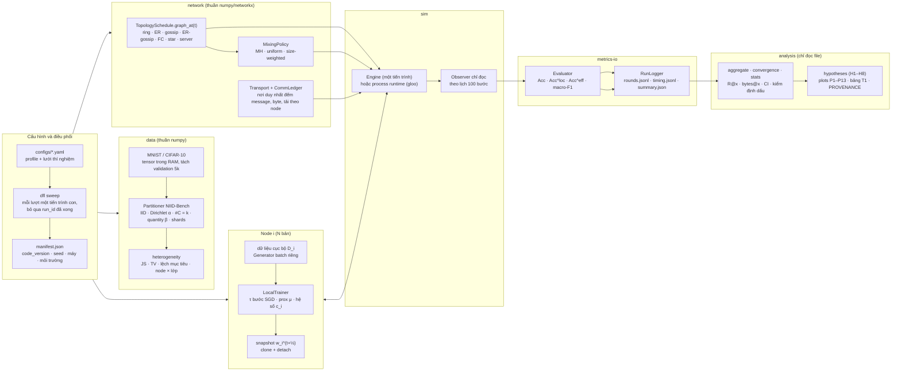

# Kiến trúc hệ thống mô phỏng DFL (REQ-11)

Tài liệu này mô tả hệ thống như code đang chạy ở `code_version` `eff6fa19…` (nhánh `grid`), không phải bản dự kiến ban đầu ở KH §4. Nguồn: SPEC §3, ADR-001…013, `src/dfl/contracts.py`.

## 1. Sơ đồ tổng quan

## 2. Một round ATC (ADR-006)

Mọi thuật toán (D-PSGD τ = 1, DFedAvg τ = 20, DFedProx μ > 0) dùng cùng một vòng Adapt-Then-Combine; τ·R = 4,000 bước cục bộ ở mọi điều kiện:

1. **Adapt:** node i chạy τ bước SGD trên dữ liệu của mình, minibatch B = 32 lấy có hoàn lại bằng Generator riêng; DFedProx cộng μ/2‖w − w_i^t‖² với anchor là tham số đầu round (clone + detach).
2. **Snapshot:** node tạo đúng một bản sao w_i^(t+½) và gửi chính nó tới mọi láng giềng của G_t qua Transport (không copy theo số láng giềng).
3. **Combine:** w_i^(t+1) = Σ_j W_ij w_j^(t+½), chỉ dùng snapshot của chính mình và inbox (INV-1), cộng theo id người gửi tăng dần, ghi ra bộ đệm mới (INV-3).
4. **Quan sát:** ở mốc đánh giá, Observer đo drift trên các snapshot (trước tổng hợp) và accuracy, consensus distance trên model sau tổng hợp; nó không tiêu thụ RNG nào của huấn luyện (INV-5).

B3 (FedAvg) đi qua **đường server**: một server ảo chỉ số N, không có dữ liệu, nhận N snapshot, tổng hợp theo n_k/n rồi gửi lại N bản, đều qua Transport, nên chi phí của server được đếm như mọi node (ADR-005).

## 3. Bất biến P2P (KH §4.5) và chỗ kiểm

| Bất biến | Nội dung | Kiểm bằng |
|---|---|---|
| INV-1 | Node chỉ đọc model của mình và inbox | T-INV-1…3, engine từ chối inbox sai |
| INV-2 | Chỉ Transport đếm byte | CommLedger là nơi duy nhất gọi `record`; T-INV-6 |
| INV-3 | Tổng hợp dùng snapshot, không cập nhật tại chỗ | T-INV-4 |
| INV-4 | W không âm, tổng hàng 1, khớp cạnh; đồ thị tĩnh liên thông, gossip liên thông theo hợp các round | kiểm ở mỗi round (`round_plan`), trước round đầu (`check_schedule_union`) |
| INV-5 | Observer chỉ đọc | T-INV-5, T-INV-12 (tắt Observer không đổi quỹ đạo) |
| INV-6 | Cùng cấu hình + seed + code_version + máy + số luồng → cùng `rounds.jsonl` | T-INV-5, T-INV-13, REP-1 |

## 4. Hai runtime (ADR-002, ADR-010)

- **Inprocess:** N node trong một tiến trình, Transport trong bộ nhớ. Dùng cho toàn bộ lưới N = 20.
- **Processes:** mỗi node một tiến trình hệ điều hành, trao đổi snapshot bằng `torch.distributed` (gloo, isend/irecv, tag = round) trên 127.0.0.1, cộng một tiến trình observer. Hai lần gom (all_gather) mỗi round ứng đúng hai chỗ engine kiểm hữu hạn. Dùng cho E8 và demo. T-INV-13: `rounds.jsonl` của hai runtime trùng từng byte.
- Thời gian giao tiếp `comm_s` chỉ khác 0 ở process runtime; mọi số đo thời gian là trên một máy (loopback).

## 5. Kết quả và tái lập (ADR-008, ADR-013)

- `results/runs/<run_id>/attempt-<k>/{manifest.json, rounds.jsonl, timing.jsonl, summary.json}`; `run_id` = hash(cấu hình chuẩn hóa + `code_version` + máy). `code_version` = sha256 của mọi `*.py` trong `src/` cùng `requirements.lock`.
- `rounds.jsonl` tất định: accuracy theo node, drift, consensus distance, message, byte, tải theo node. `timing.jsonl` không tất định: thời gian các pha, tổng và theo node.
- Lưới chạy từ worktree tách rời ở đúng commit của lưới; attempt lỗi hay bị ngắt được giữ, không xóa (INT-3). Mọi hình sinh bằng `python -m analysis.plots`, ghi `figures/PROVENANCE.json` (INT-1).
