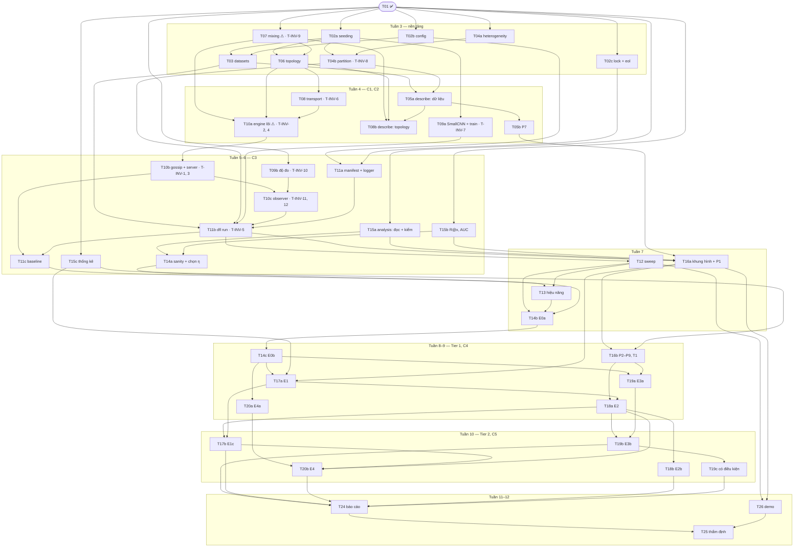

# Kế hoạch triển khai — Đề 2: Non-IID × Decentralized Federated Learning

> **Trạng thái:** nhóm đã duyệt (Gate G2, 2026-09-30); P2.2 phản biện kế hoạch sau khi duyệt, kết quả ghi ở §14 · **Ngày:** 2026-09-30
> **Nguồn:** `SPEC.md` Draft 0.3 (sau cả ba vòng phản biện của P1.9) · `docs/decisions/ADR-001…009` (Proposed) · `CONSTRAINTS.md` · `docs/KE_HOACH_DE_TAI_2.md` §7–§9 (**KH**) · `docs/HANDOFF_GUIDELINE.md` §3.2–§3.3 (**H**).
> **Checklist thực hiện:** `tasks/todo.md`. Mỗi task còn phải đạt Definition of Done (H§4.2) và `make check-task` xanh trước khi commit.

## 1. Tổng quan

Kế hoạch biến SPEC thành 42 task cỡ S hoặc M, mỗi task chạm tối đa 5 file (không tính `tasks/todo.md`, `tasks/SESSION_LOG.md`) và khoảng 300 dòng diff. Công việc chia ba lát dọc: lát dữ liệu (C1), lát mạng (C2), lát chạy trọn một lượt (C3, mốc M3). Sau đó tới công cụ thí nghiệm, lưới Tier 1 (C4), Tier 2 (C5, mốc M4), báo cáo và thẩm định. Hai task rủi ro cao nhất được đưa lên sớm. T07 (mixing) làm ngay đầu tuần 3, không đợi topology. Engine (T10a) bắt đầu ngay khi có transport, với một trainer giả theo Protocol, không đợi T09. Mọi code trong `src/` phải xong trước E0a, vì từ E0a `code_version` bị đóng băng (ADR-008).

## 2. Điều kiện trước khi bắt đầu pha 3

- ✅ P1.9 đã commit (`07b183c`). Ba vòng phản biện đã reconcile; vòng 3 còn 3 phát hiện mức cao đã sửa nhưng chưa được phản biện lại, và nhóm quyết commit như vậy (`docs/decisions/REVIEW-P1.9.md`).
- Gate G1: nhóm và GVHD duyệt SPEC, ADR (Proposed → Accepted), và trả lời Q1.
- ✅ Gate G2: nhóm duyệt kế hoạch này ngày 2026-09-30.
- Câu hỏi còn mở ảnh hưởng tới task (§12): QS-1 (T02c), QS-2 (T14b, T19a), QS-7 (CLI của T03, T05a, T12), QS-8 (T26). QS-9, QS-10, QS-11 đã chốt.

## 3. Quyết định của kế hoạch

- **K1 — Lát dọc theo checkpoint.**
  - C1 là lát dữ liệu: MNIST → cách chia → `dfl describe` → hình P7.
  - C2 là lát mạng: topology → mixing → transport → bảng spectral gap (mốc M2).
  - C3 là lát chạy trọn một lượt: `python -m dfl run` sinh đủ 4 file kết quả (mốc M3).
  - Giữa các checkpoint, mỗi task để hệ thống ở trạng thái chạy được (`make check-task` xanh) và thêm một khả năng dùng được ngay qua test hoặc lệnh.
- **K2 — Rủi ro cao làm trước.**
  - T07 chỉ cần đồ thị networkx, nên TV2 làm ngay ngày đầu tuần 3, song song với phần nền tảng.
  - T10a dùng MLP tí hon, dữ liệu tổng hợp và một trainer theo Protocol `LocalTrainer`. Nhờ vậy engine bắt đầu từ tuần 4, sớm hơn KH một tuần, và không nằm sau T09 trên đường găng.
- **K3 — Engine tách ba task, mỗi task viết test bất biến của nó trước.**
  - T10a: vòng ATC lõi (T-INV-2, T-INV-4). T10b: gossip và đường server (T-INV-1, T-INV-3). T10c: Observer (T-INV-11, T-INV-12) cùng phản biện doubt-driven cho engine.
  - Lý do tách: gộp cả sáu T-INV, engine và Observer thì vượt khoảng 300 dòng. Test đỏ lại không commit được (CONSTRAINTS F1, F2).
  - Ở mỗi task, test FAIL trước rồi mới viết code. Không dòng code engine nào có trước test bất biến của chính nó.
  - Đây là cách hiểu câu "T-INV-1…4, 11, 12 phải có trước khi viết engine" (SPEC §7, H P3.3), cần nhóm duyệt (O2).
- **K4 — Mỗi T-INV thuộc đúng một task** (§8). T-INV-6 có phần "`nbytes` tính từ tensor thật" cần torch, trong khi `network/` không được import torch. Vì vậy hàm tạo snapshot nằm ở `sim/node.py` và được làm ngay trong T08, cùng task với T-INV-6.
- **K5 — Tách hay gộp WBS** theo ba luật: tối đa 5 file mỗi task; mỗi T-INV một chủ; Tier 1 và Tier 2 tách riêng để việc cắt Tier 2 không làm dở một task (§5).
- **K6 — Mỗi nhóm thí nghiệm là một task riêng.**
  - Tier 1 chạy trước. Tier 2 chạy theo thứ tự ngược với thứ tự cắt của ADR-007: E3b → E1c → E4 → E2b.
  - Lưới hơn 10 lượt phải trình kết quả `--dry-run` cho nhóm trước khi chạy (Ask first). Thẻ tiền đăng ký phải được commit trước khi chạy (EXP-1).
- **K7 — Đóng băng code từ E0a.** Mọi task sửa `src/` (T02a–T13) phải xong trước T14b. Sau E0a chỉ còn task `analysis/`, cấu hình thí nghiệm và tài liệu. Một bản sửa lỗi sau E0a buộc chạy lại mọi lượt đã có, tức khoảng 64 giờ-lõi với Tier 1 (ADR-007, ADR-008).
- **K8 — File mới ngoài cây SPEC §5.1** (cần sửa SPEC sau khi duyệt, O3):
  - `sim/run.py`: lắp một lượt từ cấu hình. Code này không được nằm trong `cli.py`, vì `cli.py` bị loại khỏi coverage (SPEC §10 dòng 6).
  - `sim/describe.py`: lệnh `describe`.
  - `analysis/checks.py`, `analysis/sanity.py`, `analysis/provenance.py`.
  - `configs/experiments/e4a_quantity.yaml`, `docs/PERF.md`, `docs/DEMO.md`, `docs/report/*`.
- **K9 — Phân vai** (QS-9, nhóm chốt ở P2.1): TV1 nhận T09a và T09b; TV3 nhận nền tảng (T02a–c) và T11a; TV2 giữ network, engine, `run`, baseline, hiệu năng và T22 (SPEC §3.1, §10 dòng 1).
- **K10 — Khi H lệch SPEC hay ADR, làm theo SPEC và ADR** (thứ tự ưu tiên ở đầu SPEC):
  - H P3.2 gợi ý `default_rng([seed, r])` cho `graph_at`; ADR-009 dùng `SeedSequence` với spawn_key.
  - H P3.6 cho chạy lại mọi attempt lỗi; SPEC §5.3 chỉ chạy lại attempt `failed` khi có `--retry-failed`.
  - H P3.3 viết cả sáu T-INV trước; kế hoạch làm theo K3.
- **K12 — Lưới chạy từ worktree riêng** (SPEC §5.3). Sweep vào `results/` chạy từ một worktree check out đúng commit của lưới. Nhờ vậy, trong lúc lưới chạy nhiều ngày, nhóm vẫn làm được T16b, T22, T24 ở cây làm việc hằng ngày mà không đổi code của các lượt đang chạy.
- **K13 — SAN-5 kiểm trên lượt thật.** T14a cài SAN-5; nó kiểm rằng bước tổng hợp có tác dụng trên code chạy lưới, vì T-INV chỉ chạy trên MLP tí hon.
- **K11 — Không thêm phụ thuộc chạy.** `analysis/stats.py` cần giá trị tới hạn của phân phối t, nhưng numpy và pandas không có. Nó dùng bảng hai phía 95% cho df ≤ 30, có ghi nguồn. Test đối chiếu với `scipy.stats.t`, gói có sẵn trong môi trường dev qua scikit-learn.

## 4. Đồ thị phụ thuộc

**Đường găng** (TV2 nắm phần lớn): T07 → T06 → T08 → T10a → T10b → T10c → T11b → T11c → T13 → T14b (E0a) → T14c (E0b) → T17a (E1) → T18a (E2) → Tier 2 → T24 → T25. T11b còn chờ T09a (TV1) và T11a; hai task này phải xong trước giữa tuần 6.

## 5. Tách và gộp so với WBS KH §8

| KH | Kế hoạch | Lý do |
|---|---|---|
| T01 | T01 ✅ (commit `2789c5c`) | Đã xong ở P1.1 |
| T02 | T02a seeding · T02b config · T02c `requirements.lock` + `.gitattributes` | Gộp thì quá 5 file (2 module, 2 test, YAML). T02c là việc mới của P1.9 (CONSTRAINTS "Kích hoạt theo task"), phụ thuộc QS-1 và cần mạng |
| T03 | T03 (thêm `cli.py`, `__main__.py`, lệnh `download`) | SPEC §4 đặt `download` ở T03; đây là lúc tạo khung CLI |
| T04 | T04a heterogeneity · T04b partition + placement (+ P2' theo QS-11) | T-INV-8 cần JS, nên heterogeneity đi trước. Mỗi file được thêm vào contract `pure-no-torch` khi nó tồn tại (import-linter báo lỗi với module chưa có). P2' cài sẵn trước E0a để thêm lượt sau này mà không đổi `code_version` |
| T05 | T05a `describe` phần dữ liệu (`sim`) · T05b P7 (`analysis`) | Vẽ hình thuộc `analysis` (capability map); `src/dfl` chỉ ghi dữ liệu |
| (mới) | T08b `describe` phần topology | Mốc M2 cần bảng spectral gap sinh từ code; tách khỏi T07 để T07 gọn và làm được sớm |
| T06, T07 | Giữ; T07 không còn phụ thuộc T06 | K2 |
| T08 | T08 + hàm tạo snapshot ở `sim/node.py` | K4: T-INV-6 trọn trong một task |
| T09 | T09a model + huấn luyện cục bộ (T-INV-7) · T09b độ đo + Evaluator + consensus (T-INV-10) | Gộp thì quá 5 file; T09b không phụ thuộc T09a nên làm song song được |
| T10 | T10a · T10b · T10c | K3 |
| T11 | T11a manifest + logger · T11b `dfl run` + smoke (T-INV-5) · T11c baseline B1, B1-4k, B2, B3 | Gộp thì quá 5 file và khoảng 300 dòng. T11a độc lập với engine nên làm song song được |
| T12, T13 | Giữ; T13 chốt lịch đánh giá, tập con, số luồng trước E0a | SPEC §3.3, ADR-007 |
| T14 | T14a lệnh sanity + chọn η · T14b E0a · T14c E0b | E0a phải xong và ghi η vào ADR-007 trước E0b (SPEC §8) |
| T15 | T15a đọc + kiểm INT-2/3/6 · T15b R@x, AUC, dao động, sụt · T15c thống kê + quy tắc quyết định | Định nghĩa độ đo phải có test và commit trước lượt Tier 1 đầu tiên (SPEC §8) |
| T16 | T16a khung + PROVENANCE + `--draft` + P1, P7 · T16b P2–P6, P8, P9, T1 | Gộp thì quá dài |
| T17–T20 | Mỗi nhóm E là một task: Tier 1 (T17a E1, T18a E2, T19a E3a, T20a E4a), Tier 2 (T19b E3b, T17b E1c, T20b E4, T18b E2b), T19c lượt có điều kiện | K6; cắt Tier 2 không để lại task dở |
| T21–T23 | Mở rộng, chỉ làm sau M4 (Ask first); không chi tiết ở đây | SPEC §1.4. T22 thành bắt buộc nếu Q1 yêu cầu (§11) |
| (mới) | T26 demo trên laptop | ENG-11, QS-8; KH chỉ có demo ở tuần 12 mà không có task |
| T24, T25 | Giữ | |

## 6. Lịch theo tuần và việc song song

| Tuần | TV1 | TV2 | TV3 | Mốc |
|---|---|---|---|---|
| 3 | T04a → T03 → T04b | T07 → T06 | T02a, T02b, T02c | |
| 4 | T05a → T09a | T08 → T10a | T05b, T08b | C1 (đầu tuần 4); C2 = **M2** (cuối tuần 4) |
| 5 | T09b | T10b → T10c | T11a, T15b, T15c | |
| 6 | Dự phòng; soạn thẻ E1, E4a | T11b → T11c | T15a → T14a | C3 = **M3** (cuối tuần 6) |
| 7 | Soạn thẻ E1c, E4 | T13 | T12 → T16a → T14b (E0a, cuối tuần) | |
| 8 | Phân tích E1 | Sửa lỗi nếu có; T22 nếu QS-10 giữ mặc định (ở cây làm việc, không ảnh hưởng worktree của lưới) | T14c, T17a, T19a, T20a, T16b | |
| 9 | Phân tích E1, E4a | T25 chuẩn bị (REP-1 thử) | T18a | C4 |
| 10 | Phân tích E1c, E4 | | T19b → T17b → T20b → T18b (→ T19c) | C5 = **M4** |
| 11 | T26 | T25 | T24 (cả nhóm viết) | **M5** (G3) |
| 12 | Thuyết trình, demo, dự phòng | | | **M6** |

Việc song song được đánh dấu ở từng task trong `tasks/todo.md` (trường "Song song").

## 7. Checkpoint C1–C5

Mỗi checkpoint làm theo H P3.8:
1. Chạy `make check-full`.
2. Liệt kê các task và commit từ checkpoint trước.
3. Chạy lệnh demo của checkpoint.
4. Nhờ subagent `code-reviewer` review diff.
5. Đối chiếu Definition of Done.
6. Tăng `MIN_TESTS` lên bằng số test hiện có, và ghi lại coverage (CONSTRAINTS "Đo và giữ").
7. Nhóm duyệt, rồi ghi kết luận vào §13.

| Checkpoint | Sau | Lệnh demo | Thêm |
|---|---|---|---|
| C1 | T05a, T05b | `python -m dfl describe --config configs/base.yaml --seeds 20 --out build/describe`, rồi vẽ P7 | Kiểm JS trên MNIST thật theo REQ-02 |
| C2 (M2) | T08, T08b | Bảng spectral gap sinh từ code, so với KH §3.3 (ring 0.0326, FC 1, ER trung bình khoảng 0.20) | |
| C3 (M3) | T11c | `python -m dfl run --config configs/profiles/fast.yaml --out build/fast` cho ring và FC trên IID | `make check-inv` xanh đủ 12 T-INV; P3.7 (`test-engineer`); cài thử và chạy smoke trên laptop demo (phát hiện sớm QS-8) |
| C4 | T18a (và T19a, T20a nếu đã xong) | Hình Tier 1 E0–E2 từ `results/` | SAN-1…4 đã đạt; sao lưu `results/` |
| C5 (M4) | T19b, T17b, T20b, T18b, T19c | Toàn bộ P1–P9, T1 | Doubt-driven cho mỗi kết luận chính (INT-5); P3.7 lần hai; sao lưu `results/` |

## 8. T-INV → task (mỗi test đúng một chủ)

| T-INV | Task | Mức |
|---|---|---|
| T-INV-1 | T10b | integration |
| T-INV-2 | T10a | integration |
| T-INV-3 | T10b | integration |
| T-INV-4 | T10a | integration |
| T-INV-5 | T11b | e2e + integration |
| T-INV-6 | T08 | unit |
| T-INV-7 | T09a | unit |
| T-INV-8 | T04b | unit |
| T-INV-9 | T07 | unit |
| T-INV-10 | T09b | unit |
| T-INV-11 | T10c | integration |
| T-INV-12 | T10c | integration |

Tên test theo dạng `test_t_inv_<k>_<hành vi>` (SPEC §7). `make check-inv` bắt buộc từ T11b và trước mọi lượt Tier 1.

## 9. Truy vết REQ → task

| REQ | Task | Test / kiểm chứng | Hình |
|---|---|---|---|
| REQ-01 | T06, T08, T10a, T10b, T10c | T-INV-2, T-INV-4, T-INV-12; test lịch tạo độc lập (T06) | Sơ đồ kiến trúc (T24) |
| REQ-02 | T04a, T04b, T05a, T05b, T20a | T-INV-8; kiểm JS trên MNIST thật (T05a) | P7 |
| REQ-03 | T09b, T10c | T-INV-10, T-INV-11 | P1, P2, T1 |
| REQ-04 | T15b | Unit test R@x, AUC | P1, P3 |
| REQ-05 | T08, T10b | T-INV-6 | P6 |
| REQ-06 | T09b, T10b, T10c, T15b | T-INV-1, T-INV-11 | P5 |
| REQ-07 | T06, T07, T08b, T18a | T-INV-9 | P3, P8 |
| REQ-08 | T09a, T10b, T19a | T-INV-3, T-INV-7 | P9 |
| REQ-09 | T10c, T11b, T15a | e2e smoke, T-INV-11 | P1, P4, P6 |
| REQ-10 | T05b, T16a, T16b | e2e vẽ hình (T16a) | P1–P9, T1 |
| REQ-11 | T24 | Duyệt ở G1 và khi review báo cáo | Sơ đồ |
| REQ-12 | T11c, T14a, T14c | SAN-1…4 | E0b |
| REQ-13 | T15c, T24 | INT-4, INT-5 | Bảng khuyến nghị |
| REQ-14 | T03 | Unit test T03 | — |

Tiêu chí kỹ thuật và toàn vẹn:
- ENG-4, ENG-10: T11b. ENG-6: T04a, T04b, T08. ENG-7: T02a, T11b. ENG-9: T12. ENG-11: T26.
- INT-1: T16a. INT-2, INT-3, INT-6: T15a. INT-4, INT-5: T24 và C5. REP-1: T25.
- EXP-1…5: T14b–T20b và T24.

## 10. Ngân sách tính toán (ADR-007; T13 cập nhật)

- Một lượt DFL khoảng 20 phút-lõi.
- Tier 1 có 197 lượt, khoảng 64 giờ-lõi. Tier 1 + 2 có 278 lượt, khoảng 92 giờ-lõi. Cộng 24 lượt có điều kiện thì khoảng 100 giờ-lõi; kể cả 30% dự phòng thì khoảng 130.
- Với khoảng 1 lõi rảnh (tải lúc đo khoảng 7 trên 8 nhân), Tier 1 cần khoảng 2.7 ngày chạy liên tục, Tier 1 + 2 khoảng 4–5.5 ngày. Mức này vẫn vừa tuần 8–10, nhưng không đủ cho một lần chạy lại toàn bộ Tier 1.
- Hết T13 thì cập nhật mục này bằng số đo dưới tải thật.

## 11. Rủi ro và giảm thiểu

| Rủi ro | Mức | Giảm thiểu |
|---|---|---|
| TV2 nắm gần hết đường găng tuần 3–7 (topology, mixing, transport, engine, `run`) | Cao | QS-9: TV1 nhận T09a, T09b; TV3 nhận T11a, T02a–c; T10a không đợi T09; tuần 6–7 có dự phòng |
| Lỗi engine làm sai mọi kết luận | Cao | Mỗi bước engine có T-INV viết trước (K3); doubt-driven ở T10c; P3.7 ở C3; `check-inv` trước E0a |
| Phát hiện lỗi sau E0a buộc chạy lại mọi lượt (khoảng 64 giờ-lõi với Tier 1) | Cao | K7; review C3 và P3.7 trước T14b; T13 chạy thử cấu hình full trước khi mở lưới |
| GVHD trả lời Q1 là "cần P2P thật", hoặc không trả lời | Trung bình | Hạn chót cuối tuần 5 (ADR-002). Nếu "có": T22 (M) thành bắt buộc trước T14b; TV1 hoặc TV3 làm ở tuần 6–7. Nếu không có trả lời: theo QS-10, TV2 làm T22 ở tuần 8–10, sau T13 |
| Máy chủ dùng chung, số lõi rảnh thấp | Trung bình | Đo ở T13; mở E0a sớm nhất có thể (cuối tuần 7); cắt Tier 2 theo ADR-007 (Ask first) |
| SAN không đạt mà không tìm ra lỗi | Trung bình | B1-4k làm chẩn đoán; quy trình SPEC §9.3 (dừng, báo nhóm) |
| Cần mạng để tạo file khóa và tải MNIST | Thấp | Làm ở tuần 3 (T02c, T03); laptop demo tải trước (T26) |
| Laptop demo chưa rõ hệ điều hành (QS-8) | Thấp | Cài thử ở C3; T26 đo thời gian thật |
| SPEC còn 3 bản sửa mức cao (vòng 3 của P1.9) chưa được phản biện lại | Trung bình | Nhóm quyết có phản biện riêng từng phần hay không (REVIEW-P1.9, mục STOP); nếu SPEC đổi thì sửa kế hoạch tại chỗ trước G2 |
| Agent đọc H và làm theo chỗ H lệch SPEC | Thấp | K10; mô tả task ghi rõ chỗ lệch (T06, T12) |

## 12. Câu hỏi mở

Đã chốt ở P2.1 (nhóm duyệt ngày 2026-09-30):
- O1 (QS-9) phân vai như K9.
- O2: engine tách ba task T10a–c, mỗi task viết T-INV của nó trước (SPEC §7, §10 dòng 38).
- O3: các file mới ở K8 đã vào cây SPEC §5.1 (§10 dòng 39).
- O10 (QS-10): nếu tới hết tuần 5 GVHD chưa trả lời Q1, T22 làm ngay sau T13.
- O11 (QS-11): cài sẵn P2' ở T04b, chỉ dùng trong `describe`.

Còn mở:
- **O4 (QS-1):** file khóa chỉ gồm gói chạy (mặc định). Ảnh hưởng T02c và T11a.
- **O5 (SPEC §1.4):** có viết sẵn hook cho phần mở rộng (tham số dataset cho E6, topology T5) trước E0a không? Mặc định: không; phần mở rộng chỉ so định tính.
- **O6 (QS-8):** laptop demo chạy hệ điều hành gì? Ảnh hưởng T26 và việc cài thử ở C3.
- **O7 (Q1, Q2, Q9, chờ GVHD):** Q1 quyết định T22 có bắt buộc trước E0a không; Q2 (hạn nộp) có thể dời tuần 11–12; Q9 xác nhận cách ánh xạ bốn loại phân phối.
- **O8:** HANDOFF còn hai chỗ lệch SPEC/ADR (K10); kế hoạch làm theo SPEC. Có sửa HANDOFF cho khớp không?
- **O9 (QS-2):** μ của DFedProx được chốt cùng η ở T14b, theo mặc định QS-2; ảnh hưởng cấu hình của T19a và T19b.

## 13. Nhật ký checkpoint (điền ở P3.8)

| Checkpoint | Ngày | Commit | `make check-full` | `MIN_TESTS` / coverage | Kết luận của nhóm |
|---|---|---|---|---|---|
| C1 | | | | | |
| C2 | | | | | |
| C3 | | | | | |
| C4 | | | | | |
| C5 | | | | | |

## 14. Phản biện kế hoạch (P2.2)

_(điền sau khi chạy)_
