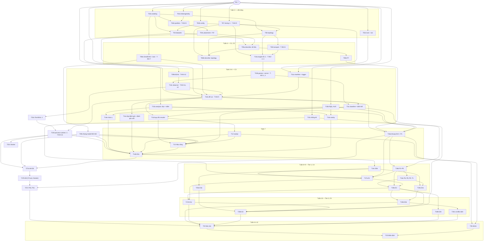

# Kế hoạch triển khai — Đề 2: Non-IID × Decentralized Federated Learning

> **Trạng thái:** nhóm đã duyệt (Gate G2, 2026-09-30); P2.2 phản biện kế hoạch sau khi duyệt, kết quả ghi ở §14 · **Ngày:** 2026-09-30
> **Sửa đổi 2026-10-01 (nhóm duyệt ngày 2026-10-01; Q12: Docker tùy chọn; Q13: đo cả byte lẫn thời gian):** GVHD trả lời Q1: cần tiến trình chạy song song, mỗi node độc lập; có thể dùng Docker với ít container; tăng độ phức tạp model để xem chi phí giao tiếp. Kế hoạch đổi theo K14 (ADR-010, ADR-011): T22a, T22b thành bắt buộc trước E0a, T22c (Docker) tùy chọn; thêm T09c và E8 (T27a–c); tổng cộng 54 task.
> **Nguồn:** `SPEC.md` Draft 0.3 (sau cả ba vòng phản biện của P1.9) · `docs/decisions/ADR-001…009` (Proposed) · `CONSTRAINTS.md` · `docs/KE_HOACH_DE_TAI_2.md` §7–§9 (**KH**) · `docs/HANDOFF_GUIDELINE.md` §3.2–§3.3 (**H**).
> **Checklist thực hiện:** `tasks/todo.md`. Mỗi task còn phải đạt Definition of Done (H§4.2) và `make check-task` xanh trước khi commit.

## 1. Tổng quan

Kế hoạch biến SPEC thành 49 task cỡ S hoặc M (gồm T22a, T22b), mỗi task chạm tối đa 5 file (không tính `tasks/todo.md`, `tasks/SESSION_LOG.md`) và khoảng 300 dòng diff. Công việc chia ba lát dọc: lát dữ liệu (C1), lát mạng (C2), lát chạy trọn một lượt (C3, mốc M3). Sau đó tới công cụ thí nghiệm, lưới Tier 1 (C4), Tier 2 (C5, mốc M4), báo cáo và thẩm định. Hai task rủi ro cao nhất được đưa lên sớm. T07 (mixing) làm ngay đầu tuần 3, không đợi topology. Engine (T10a) bắt đầu ngay khi có transport, với một trainer giả theo Protocol, không đợi T09. Mọi code trong `src/` phải xong trước E0a, vì từ E0a `code_version` bị đóng băng (ADR-008).

## 2. Điều kiện trước khi bắt đầu pha 3

- ✅ P1.9 đã commit (`07b183c`). Ba vòng phản biện đã reconcile; vòng 3 còn 3 phát hiện mức cao đã sửa nhưng chưa được phản biện lại, và nhóm quyết commit như vậy (`docs/decisions/REVIEW-P1.9.md`).
- Gate G1: nhóm và GVHD duyệt SPEC, ADR (Proposed → Accepted). Q1 đã trả lời ngày 2026-10-01 (K14); còn chờ Q10–Q13.
- ✅ Gate G2: nhóm duyệt kế hoạch này ngày 2026-09-30.
- Câu hỏi còn mở ảnh hưởng tới task (§12): QS-1 (T02c), QS-2 (T14b, T19a), QS-7 (CLI của T03, T05a, T12), QS-8 (T26). QS-9, QS-10, QS-11 đã chốt.

## 3. Quyết định của kế hoạch

- **K1 — Lát dọc theo checkpoint.**
  - C1 là lát dữ liệu: MNIST → cách chia → `dfl describe` → hình P7.
  - C2 là lát mạng: topology → mixing → transport → bảng spectral gap (mốc M2).
  - C3 là lát chạy trọn một lượt: `python -m dfl run` sinh đủ 4 file kết quả (mốc M3).
  - Giữa các checkpoint, mỗi task để hệ thống ở trạng thái chạy được (`make check-task` xanh) và thêm một khả năng dùng được ngay qua test hoặc lệnh.
- **K2 — Rủi ro cao làm trước.**
  - T07 chỉ cần đồ thị networkx, nên TV2 làm ngay ngày đầu tuần 3, song song với phần nền tảng.
  - T10a dùng MLP tí hon, dữ liệu tổng hợp và một trainer theo Protocol `LocalTrainer`. Nhờ vậy engine bắt đầu từ tuần 4, sớm hơn KH một tuần, và không nằm sau T09 trên đường găng.
- **K3 — Engine tách ba task, mỗi task viết test bất biến của nó trước.**
  - T10a: vòng ATC lõi (T-INV-2, T-INV-4). T10b: gossip và đường server (T-INV-1, T-INV-3). T10c: Observer (T-INV-11, T-INV-12) cùng phản biện doubt-driven cho engine.
  - Lý do tách: gộp cả sáu T-INV, engine và Observer thì vượt khoảng 300 dòng. Test đỏ lại không commit được (CONSTRAINTS F1, F2).
  - Ở mỗi task, test FAIL trước rồi mới viết code. Không dòng code engine nào có trước test bất biến của chính nó.
  - Đây là cách hiểu câu "T-INV-1…4, 11, 12 phải có trước khi viết engine" (SPEC §7, H P3.3), cần nhóm duyệt (O2).
- **K4 — Mỗi T-INV thuộc đúng một task** (§8). T-INV-6 có phần "`nbytes` tính từ tensor thật" cần torch, trong khi `network/` không được import torch. Vì vậy hàm tạo snapshot nằm ở `sim/node.py` và được làm ngay trong T08, cùng task với T-INV-6.
- **K5 — Tách hay gộp WBS** theo ba luật: tối đa 5 file mỗi task; mỗi T-INV một chủ; Tier 1 và Tier 2 tách riêng để việc cắt Tier 2 không làm dở một task (§5).
- **K6 — Mỗi nhóm thí nghiệm là một task riêng.**
  - Tier 1 chạy trước. Tier 2 chạy theo thứ tự ngược với thứ tự cắt của ADR-007: E3b → E1c → E4 → E2b.
  - Lưới hơn 10 lượt phải trình kết quả `--dry-run` cho nhóm trước khi chạy (Ask first). Thẻ tiền đăng ký phải được commit trước khi chạy (EXP-1).
- **K7 — Đóng băng code của lưới từ E0a.** Mọi task sửa `src/` dùng cho lưới (T02a–T13) phải xong trước T14b. Sau E0a chỉ còn task `analysis/`, cấu hình thí nghiệm và tài liệu. Ngoại lệ duy nhất là T22: nó được commit vào nhánh chính, không dùng cho lưới, vì mọi sweep của lưới chạy từ worktree của commit lưới (SPEC §8). Một bản sửa lỗi sau E0a buộc chạy lại mọi lượt đã có, tức khoảng 64 giờ-lõi với Tier 1 (ADR-007, ADR-008).
- **K8 — File mới ngoài cây SPEC §5.1** (cần sửa SPEC sau khi duyệt, O3):
  - `sim/run.py`: lắp một lượt từ cấu hình. Code này không được nằm trong `cli.py`, vì `cli.py` bị loại khỏi coverage (SPEC §10 dòng 6).
  - `sim/describe.py`: lệnh `describe`.
  - `analysis/checks.py`, `analysis/sanity.py`, `analysis/provenance.py`.
  - `configs/experiments/e4a_quantity.yaml`, `docs/PERF.md`, `docs/DEMO.md`, `docs/report/*`.
- **K9 — Phân vai** (QS-9, nhóm chốt ở P2.1): TV1 nhận T09a và T09b; TV3 nhận nền tảng (T02a–c) và T11a; TV2 giữ network, engine, `run`, baseline, hiệu năng và T22 (SPEC §3.1, §10 dòng 1).
- **K10 — Khi H lệch SPEC hay ADR, làm theo SPEC và ADR** (thứ tự ưu tiên ở đầu SPEC):
  - H P3.2 gợi ý `default_rng([seed, r])` cho `graph_at`; ADR-009 dùng `SeedSequence` với spawn_key.
  - H P3.6 cho chạy lại mọi attempt lỗi; SPEC §5.3 chỉ chạy lại attempt `failed` khi có `--retry-failed`.
  - H P3.3 viết cả sáu T-INV trước; kế hoạch làm theo K3.
- **K12 — Lưới chạy từ worktree riêng** (SPEC §5.3). Sweep vào `results/` chạy từ một worktree check out đúng commit của lưới. Nhờ vậy, trong lúc lưới chạy nhiều ngày, nhóm vẫn làm được T16b, T22, T24 ở cây làm việc hằng ngày mà không đổi code của các lượt đang chạy.
- **K13 — SAN-5 kiểm trên lượt thật.** T14a cài SAN-5; nó kiểm rằng bước tổng hợp có tác dụng trên code chạy lưới, vì T-INV chỉ chạy trên MLP tí hon.
- **K14 — Đa tiến trình là yêu cầu bắt buộc (trả lời Q1, 2026-10-01; ADR-010, ADR-011).**
  - Mỗi node là một tiến trình riêng: tiến trình cục bộ cho test và E8; container Docker (4–8) là tùy chọn (Q12), cho demo và 4 ô thêm của E8. Giao tiếp qua gloo; logic node dùng chung `sim/node.py` với bộ mô phỏng.
  - Bộ mô phỏng một tiến trình vẫn chạy lưới N = 20 (ADR-002), vì T-INV-13 buộc hai runtime cho `rounds.jsonl` trùng từng byte. Nếu GVHD trả lời Q10 là phải chạy cả lưới đa tiến trình thì ADR-010 thay thế ADR-002 và §10 tính lại.
  - T22a, T22b và T09c là code của lưới, phải xong trước T14b (K7). T22c nằm ngoài `src/` nên không chặn E0a. E8 (thang model M0–M3 × ring, gossip, FC) là nhóm thí nghiệm bắt buộc theo yêu cầu của GVHD, chạy song song với Tier 1.
  - Thay QS-10: T22 không còn lịch tuần 8–10.
- **K11 — Không thêm phụ thuộc chạy.** `analysis/stats.py` cần giá trị tới hạn của phân phối t, nhưng numpy và pandas không có. Nó dùng bảng hai phía 95% cho df ≤ 30, có ghi nguồn. Test đối chiếu với `scipy.stats.t`, gói có sẵn trong môi trường dev qua scikit-learn.

## 4. Đồ thị phụ thuộc

**Đường găng** (TV2 nắm phần lớn): T07 → T06 → T08 → T10a → T10b → T10c → T11b → T22b (sau T22a) → T13 → T14b (E0a) → T14c (E0b) → T17a (E1) → T18a (E2) → Tier 2 → T24 → T25. T11b còn chờ T09a (TV1) và T11a; hai task này phải xong trước giữa tuần 6.

## 5. Tách và gộp so với WBS KH §8

| KH | Kế hoạch | Lý do |
|---|---|---|
| T01 | T01 ✅ (commit `2789c5c`) | Đã xong ở P1.1 |
| T02 | T02a seeding · T02b config · T02c `requirements.lock` + `.gitattributes` | Gộp thì quá 5 file (2 module, 2 test, YAML). T02c là việc mới của P1.9 (CONSTRAINTS "Kích hoạt theo task"), phụ thuộc QS-1 và cần mạng |
| T03 | T03 (thêm `cli.py`, `__main__.py`, lệnh `download`) | SPEC §4 đặt `download` ở T03; đây là lúc tạo khung CLI |
| T04 | T04a heterogeneity · T04b partition P0–P3 · T04c placement + P2' (QS-11) | T-INV-8 cần JS, nên heterogeneity đi trước. Mỗi file được thêm vào contract `pure-no-torch` khi nó tồn tại (import-linter báo lỗi với module chưa có). P2' cài sẵn trước E0a để thêm lượt sau này mà không đổi `code_version` |
| T05 | T05a `describe` phần dữ liệu (`sim`) · T05b P7 (`analysis`) | Vẽ hình thuộc `analysis` (capability map); `src/dfl` chỉ ghi dữ liệu |
| (mới) | T08b `describe` phần topology | Mốc M2 cần bảng spectral gap sinh từ code; tách khỏi T07 để T07 gọn và làm được sớm |
| T06, T07 | Giữ; T07 không còn phụ thuộc T06 | K2 |
| T08 | T08 + hàm tạo snapshot ở `sim/node.py` | K4: T-INV-6 trọn trong một task |
| T09 | T09a model + huấn luyện cục bộ (T-INV-7) · T09b độ đo + Evaluator + consensus (T-INV-10) | Gộp thì quá 5 file; T09b không phụ thuộc T09a nên làm song song được |
| T10 | T10a · T10b · T10c | K3 |
| T11 | T11a manifest + logger · T11b `dfl run` + smoke (T-INV-5) · T11d quy tắc ghi `results/`, phân kỳ, lỗi · T11c baseline và biến thể trộn | Gộp thì quá 5 file và khoảng 300 dòng. T11a độc lập với engine nên làm song song được |
| T12, T13 | Giữ; T13 chốt lịch đánh giá, tập con, số luồng trước E0a | SPEC §3.3, ADR-007 |
| T14 | T14a lệnh sanity + chọn η · T14b E0a · T14c E0b | E0a phải xong và ghi η vào ADR-007 trước E0b (SPEC §8) |
| T15 | T15a đọc + kiểm INT-2/3/6 · T15b R@x, AUC, dao động, sụt · T15c thống kê + quy tắc quyết định | Định nghĩa độ đo phải có test và commit trước lượt Tier 1 đầu tiên (SPEC §8) |
| T16 | T16a khung + PROVENANCE + `--draft` + P1, P7 · T16b P2–P5 · T16c P6, P8, P9, T1 | Gộp thì quá dài (P2.2: bảy hình trong một task vượt khoảng 300 dòng); T16b làm trong lúc E0b chạy, vì E1 cần P2, P4 |
| T17–T20 | Mỗi nhóm E là một task: Tier 1 (T17a E1, T18a E2, T19a E3a, T20a E4a), Tier 2 (T19b E3b, T17b E1c, T20b E4, T18b E2b), T19c lượt có điều kiện | K6; cắt Tier 2 không để lại task dở |
| T21, T23 | Mở rộng, chỉ làm sau M4 (Ask first); không chi tiết ở đây | SPEC §1.4 |
| T22 | Tách thành T22a (Transport gloo), T22b (process runtime + observer, T-INV-13), T22c (Docker, tùy chọn); T22a, T22b bắt buộc trước E0a | Q1 đã trả lời 2026-10-01 (K14, ADR-010); QS-10 không còn áp dụng |
| T09c, T27a–c | Mới: thang model M0–M3 và E8 (thẻ, chạy, phân tích) | Yêu cầu "tăng độ phức tạp" của GVHD (ADR-011) |
| (mới) | T26 demo trên laptop | ENG-11, QS-8; KH chỉ có demo ở tuần 12 mà không có task |
| T24, T25 | Giữ | |

## 6. Lịch theo tuần và việc song song

| Tuần | TV1 | TV2 | TV3 | Mốc |
|---|---|---|---|---|
| 3 | T04a → T03 → T04b → T04c | T07 → T06 | T02a, T02b, T02c | |
| 4 | T05a → T09a | T08 → T10a | T05b, T08b | C1 (đầu tuần 4); C2 = **M2** (cuối tuần 4) |
| 5 | T09b → T09c | T10b → T10c → T22a | T11a, T15b, T15c | |
| 6 | T14a; soạn thẻ E1, E4a | T11b → T22b → T11c | T15a, T11d; chuẩn bị Dockerfile của T22c | C3 = **M3** (cuối tuần 6) |
| 7 | Soạn thẻ E1c, E4, E8 | T13 | T12 → T16a → T14b (E0a, cuối tuần); T22c nếu kịp (tùy chọn) | |
| 8 | T16b (trong lúc E0b chạy), T16c; phân tích E1 | Sửa lỗi nếu có; theo dõi E8 trong Docker | T14c, T27a → T27b (E8), T17a, T19a, T20a | |
| 9 | Phân tích E1, E4a; T27c (E8) | T25 chuẩn bị (REP-1 thử) | T18a (và phần còn lại của T19a, T20a, T27b) | C4 (đủ Tier 1 và E8) |
| 10 | Phân tích E1c, E4 | | T19b → T17b → T20b → T18b (→ T19c) | C5 = **M4** |
| 11 | T26 | T25 | T24 (cả nhóm viết) | **M5** (G3) |
| 12 | Thuyết trình, demo, dự phòng | | | **M6** |

Việc song song được đánh dấu ở từng task trong `tasks/todo.md` (trường "Song song").

## 7. Checkpoint C1–C5

Mỗi checkpoint làm theo H P3.8:
1. Chạy `make check-full`.
2. Liệt kê các task và commit từ checkpoint trước.
3. Chạy lệnh demo của checkpoint.
4. Nhờ subagent `code-reviewer` review diff.
5. Đối chiếu Definition of Done.
6. Tăng `MIN_TESTS` lên bằng số test hiện có, và ghi lại coverage (CONSTRAINTS "Đo và giữ").
7. Nhóm duyệt, rồi ghi kết luận vào §13.

| Checkpoint | Sau | Lệnh demo | Thêm |
|---|---|---|---|
| C1 | T05a, T05b | `python -m dfl describe --config configs/base.yaml --seeds 20 --out build/describe --check-req02`, rồi vẽ P7 vào `build/describe` | Kiểm JS trên MNIST thật theo REQ-02 (mã thoát 0); hình chưa vào `figures/`, vì PROVENANCE chỉ có từ T16a (INT-1) |
| C2 (M2) | T08, T08b | Bảng spectral gap sinh từ code, so với KH §3.3 (ring 0.0326, FC 1, ER trung bình khoảng 0.20) | |
| C3 (M3) | T11c, T11d | `python -m dfl run --config configs/profiles/fast.yaml --out build/fast` cho ring và FC trên IID | `make check-inv` xanh đủ 12 T-INV; P3.7 (`test-engineer`); cài thử và chạy smoke trên laptop demo (phát hiện sớm QS-8) |
| C4 | T18a, T19a, T20a, T27b (đủ 269 lượt của Tier 1: 197 lưới lõi + 72 E8) | Hình Tier 1 từ `results/` | SAN-1…5 đã đạt; sao lưu `results/`; Tier 2 chỉ mở sau C4 |
| C5 (M4) | T19b, T17b, T20b, T18b, T19c | Toàn bộ P1–P9, T1 | Doubt-driven cho mỗi kết luận chính (INT-5); P3.7 lần hai; sao lưu `results/` |

## 8. T-INV → task (mỗi test đúng một chủ)

| T-INV | Task | Mức |
|---|---|---|
| T-INV-1 | T10b | integration |
| T-INV-2 | T10a | integration |
| T-INV-3 | T10b | integration |
| T-INV-4 | T10a | integration |
| T-INV-5 | T11b | e2e + integration |
| T-INV-6 | T10b (qua engine; T08 có test thành phần của CommLedger) | integration |
| T-INV-7 | T09a | unit |
| T-INV-8 | T04b | unit |
| T-INV-9 | T07 | unit |
| T-INV-10 | T09b | unit |
| T-INV-11 | T10c | integration |
| T-INV-12 | T10c | integration |
| T-INV-13 | T22b (tiến trình cục bộ); T22c kiểm lại trong Docker bằng `make check-docker` (tùy chọn) | integration |

Tên test theo dạng `test_t_inv_<k>_<hành vi>` (SPEC §7). `make check-inv` bắt buộc từ T11b và trước mọi lượt Tier 1.

## 9. Truy vết REQ → task

| REQ | Task | Test / kiểm chứng | Hình |
|---|---|---|---|
| REQ-01 | T06, T08, T10a, T10b, T10c | T-INV-2, T-INV-4, T-INV-12; test lịch tạo độc lập (T06) | Sơ đồ kiến trúc (T24) |
| REQ-02 | T04a, T04b, T05a, T05b, T20a | T-INV-8; kiểm JS trên MNIST thật (T05a) | P7 |
| REQ-03 | T09b, T10c | T-INV-10, T-INV-11 | P1, P2, T1 |
| REQ-04 | T15b | Unit test R@x, AUC | P1, P3 |
| REQ-05 | T08, T10b | T-INV-6 | P6 |
| REQ-06 | T09b, T10b, T10c, T15b | T-INV-1, T-INV-11 | P5 |
| REQ-07 | T06, T07, T08b, T18a | T-INV-9 | P3, P8 |
| REQ-08 | T09a, T10b, T19a | T-INV-3, T-INV-7 | P9 |
| REQ-09 | T10c, T11b, T15a | e2e smoke, T-INV-11 | P1, P4, P6 |
| REQ-10 | T05b, T16a, T16b, T16c | e2e vẽ hình (T16a) | P1–P9, T1 |
| REQ-11 | T24 | Duyệt ở G1 và khi review báo cáo | Sơ đồ |
| REQ-12 | T11c, T14a, T14c | SAN-1…4 | E0b |
| REQ-13 | T15c, T24 | INT-4, INT-5 | Bảng khuyến nghị |
| REQ-14 | T03 | Unit test T03 | — |

Tiêu chí kỹ thuật và toàn vẹn:
- ENG-4, ENG-10: T11b. ENG-6: T04a, T04b, T08. ENG-7: T02a, T11b. ENG-9: T12. ENG-11: T26.
- INT-1: T16a. INT-2, INT-3, INT-6: T15a. INT-4, INT-5: T24 và C5. REP-1: T25.
- EXP-1…5: T14b–T20b và T24.

## 10. Ngân sách tính toán (ADR-007; T13 cập nhật ngày 2026-10-15, chi tiết ở `docs/PERF.md`)

- **Một lượt DFL đủ ngân sách** (N = 20, 4,000 bước, τ = 20): 19.2 phút-lõi, đo một lượt `full` thật. Trong đó huấn luyện 724 s, đánh giá 40 mốc 366 s. τ = 1 tốn 22.5 phút-lõi; B1 khoảng 4.4; B1-4k khoảng 1.4.
- **Lưới lõi Tier 1** (197 lượt): khoảng 62 giờ-lõi.
- **E8** (72 lượt, R = 50): khoảng 5 giờ-lõi, khoảng 2.3 giờ thực khi chạy lần lượt. Lượt M3 tốn nhất, khoảng 5.7 phút thực, chủ yếu cho đánh giá. Giữ R = 50 như ADR-011.
- **Tier 2** (81 lượt): khoảng 26.5 giờ-lõi; 24 lượt có điều kiện thêm khoảng 8.3. Tổng khoảng 103 giờ-lõi, khoảng 134 kể cả 30% dự phòng.
- **Lõi rảnh đo ngày 2026-10-15:** 6.7–7.8 trên 8 (load average cao vì tiến trình chờ đĩa, không vì CPU). 7 worker chạy cùng lúc chậm thêm 15% mỗi lượt.
- **Thời gian thực:**
  - Với 6 worker: Tier 1 khoảng 12 giờ cộng E8 2.3 giờ; Tier 1 + 2 + có điều kiện khoảng 20 giờ (26 giờ kể cả dự phòng).
  - Nếu tải trở lại mức ngày 2026-09-30 (khoảng 1 lõi rảnh): khoảng 4.4 ngày (5.7 kể cả dự phòng).
  - Cả hai mức đều vừa tuần 8–10. Ở mức 7 lõi rảnh còn đủ chạy lại toàn bộ Tier 1 một lần.
- **Không cắt gì theo ADR-007:** lịch đánh giá mỗi 100 bước, tập con 2,000 ảnh và `threads: 1` của `configs/base.yaml` giữ nguyên. Profile `configs/profiles/full.yaml` đúng bằng mặc định này.
- **Process runtime:** 0.49 GB RAM mỗi tiến trình node MNIST, nên N = 20 cần khoảng 10 GB. Chạy cả lưới đa tiến trình (Q10) vừa RAM, nhưng mỗi lượt chiếm N + 1 tiến trình, nên số worker phải chia theo số lõi.
- **Trước mỗi sweep lớn:** đo lõi rảnh (`scripts/perf_t13.py cores`), rồi đặt `--workers` bằng số lõi rảnh trừ 1.

## 11. Rủi ro và giảm thiểu

| Rủi ro | Mức | Giảm thiểu |
|---|---|---|
| TV2 nắm gần hết đường găng tuần 3–7 (topology, mixing, transport, engine, `run`) | Cao | QS-9: TV1 nhận T09a, T09b; TV3 nhận T11a, T02a–c; T10a không đợi T09; tuần 6–7 có dự phòng |
| Lỗi engine làm sai mọi kết luận | Cao | Mỗi bước engine có T-INV viết trước (K3); doubt-driven ở T10c; P3.7 ở C3; `check-inv` trước E0a |
| Phát hiện lỗi sau E0a buộc chạy lại mọi lượt (khoảng 64 giờ-lõi với Tier 1) | Cao | K7; review C3 và P3.7 trước T14b; T13 chạy thử cấu hình full trước khi mở lưới |
| Đã xảy ra (2026-10-01): GVHD trả lời Q1 là cần tiến trình song song | Cao | K14: T22a, T22b và T09c xong trước T14b. Đường găng dài thêm khoảng một tuần ở TV2; TV1 nhận T09c; T22c (TV3) là tùy chọn. Nếu tuần 7 trễ, dời E0a tối đa 3 ngày, rồi mới cắt Tier 2 theo ADR-007 (Ask first) |
| Gloo treo (deadlock) hay lỗi cổng, khi nhiều tiến trình chạy song song | Trung bình | Thứ tự gửi/nhận cố định, id nhỏ gửi trước; timeout ở mọi test; mỗi lượt một cổng riêng; T22a có test cho ring và FC |
| Hai runtime không trùng từng bit (T-INV-13 fail) | Trung bình | Mỗi tiến trình một luồng; cùng hàm `combine`; mã hóa state được kiểm trùng từng bit; nếu vẫn lệch thì làm P3.4 (debug), không hạ T-INV-13 thành allclose khi chưa được duyệt |
| Docker: build cần mạng; máy dùng chung thiếu RAM | Thấp | Build image ở tuần 6–7 khi có mạng; N ≤ 8; đo RAM ở T13; laptop demo không bắt buộc có Docker |
| Máy chủ dùng chung, số lõi rảnh thấp | Trung bình | Đo ở T13; mở E0a sớm nhất có thể (cuối tuần 7); cắt Tier 2 theo ADR-007 (Ask first) |
| SAN không đạt mà không tìm ra lỗi | Trung bình | B1-4k làm chẩn đoán; quy trình SPEC §9.3 (dừng, báo nhóm) |
| Cần mạng để tạo file khóa và tải MNIST | Thấp | Làm ở tuần 3 (T02c, T03); laptop demo tải trước (T26) |
| Laptop demo chưa rõ hệ điều hành (QS-8) | Thấp | Cài thử ở C3; T26 đo thời gian thật |
| SPEC còn 3 bản sửa mức cao (vòng 3 của P1.9) chưa được phản biện lại | Trung bình | Nhóm quyết có phản biện riêng từng phần hay không (REVIEW-P1.9, mục STOP); nếu SPEC đổi thì sửa kế hoạch tại chỗ trước G2 |
| Agent đọc H và làm theo chỗ H lệch SPEC | Thấp | K10; mô tả task ghi rõ chỗ lệch (T06, T12) |
| G1 (GVHD) trễ, hoặc GVHD yêu cầu đổi thiết kế cơ bản sau khi pha 3 đã bắt đầu | Trung bình | Pha 3 chỉ bắt đầu sau G1 (§2). Nếu G1 trễ, chỉ làm trước các task ít phụ thuộc vào quyết định của GVHD: T02a–c, T07, T04a. Q1 có phương án dự phòng (T22, QS-10) |

## 12. Câu hỏi mở

Đã chốt ở P2.1 (nhóm duyệt ngày 2026-09-30):
- O1 (QS-9) phân vai như K9.
- O2: engine tách ba task T10a–c, mỗi task viết T-INV của nó trước (SPEC §7, §10 dòng 38).
- O3: các file mới ở K8 đã vào cây SPEC §5.1 (§10 dòng 39).
- O10 (QS-10): nếu tới hết tuần 5 GVHD chưa trả lời Q1, T22 làm ngay sau T13. Không còn áp dụng: GVHD đã trả lời Q1 ngày 2026-10-01 (K14).
- O11 (QS-11): cài sẵn P2' ở T04b, chỉ dùng trong `describe`.
- O4 (QS-1): file khóa chỉ gồm gói chạy; chốt ngày 2026-10-01 ở T02c.

Còn mở:
- **O5 (SPEC §1.4):** có viết sẵn hook cho phần mở rộng (tham số dataset cho E6, topology T5) trước E0a không? Mặc định: không; phần mở rộng chỉ so định tính.
- **O6 (QS-8):** laptop demo chạy hệ điều hành gì? Ảnh hưởng T26 và việc cài thử ở C3.
- **O7 (Q2, Q9, chờ GVHD):** Q2 (hạn nộp) có thể dời tuần 11–12; Q9 xác nhận cách ánh xạ bốn loại phân phối. Q1 đã trả lời (K14).
- **O12 (Q10, Q11, nhóm quyết sau):** chạy cả lưới đa tiến trình hay không (Q10); "độ phức tạp" có phải kích thước model không (Q11). Trong lúc chờ, dùng mặc định của ADR-010, ADR-011. Q12 (Docker tùy chọn) và Q13 (đo cả byte lẫn thời gian) đã chốt ngày 2026-10-01.
- O13: sửa SPEC, Makefile (`check-inv` đếm tới 13) và CONSTRAINTS theo ADR-010, ADR-011 — làm ngày 2026-10-01, sau khi nhóm duyệt K14. `make check-docker` được thêm ở T22c. KH chưa sửa: theo SPEC §10 (dòng 40), KH được cập nhật sau Gate G1.
- **O8:** HANDOFF còn hai chỗ lệch SPEC/ADR (K10); kế hoạch làm theo SPEC. Có sửa HANDOFF cho khớp không?
- **O9 (QS-2):** μ của DFedProx được chốt cùng η ở T14b, theo mặc định QS-2; ảnh hưởng cấu hình của T19a và T19b.

## 13. Nhật ký checkpoint (điền ở P3.8)

| Checkpoint | Ngày | Commit | `make check-full` | `MIN_TESTS` / coverage | Kết luận của nhóm |
|---|---|---|---|---|---|
| C1 | | | | | |
| C2 | 2026-10-16 | bb2fabf | Xanh: sàn, ruff, import-linter 5/5, `check-inv` 13/13 T-INV (86 test), 882 test, `pip check`; 4 phút 56 giây | 611 → 882; coverage 95.19% dòng | **Chờ nhóm duyệt.** Demo `python -m dfl describe --config configs/base.yaml --seeds 20 --out build/c2` (N = 20): ring 0.0326, FC 1.000, ER p = 0.3 TB 0.233 (0.149–0.340, seed 0 là 0.182), T3 tốc độ trộn 0.312, T3b 0.062, T0 server 40 message/round. Review `code-reviewer` của T08b: không Critical, 3 Important đã sửa ở bb2fabf (T0 đếm theo đường server 2N; cột KH chỉ in ở N = 20, p = 0.3; N nhỏ không làm dừng lệnh). Cần nhóm quyết: ER của code lệch KH §3.3 (TB 0.198, 0.085–0.310) vì spike tạo Generator thẳng từ seed, còn lượt chạy dùng Stream.GRAPH; có sửa bảng KH theo số của code không. C1 vẫn chưa làm |
| C3 | 2026-10-02 | 2adb226 | Xanh: sàn, ruff, import-linter 5/5, `check-inv` 13/13 T-INV (72 test), 611 test, `pip check`; 3 phút 12 giây | 34 → 611; coverage 95.2% dòng (94.6% dòng + nhánh) | **Nhóm duyệt ngày 2026-10-02** (người dùng trả lời "duyệt"), với các mục còn mở chuyển thành việc trước E0a. Đạt: check-full, check-inv, demo fast ring/FC trên MNIST (0.9797/0.9816), pilot B1 và FC-IID chỉ trên validation (0.9626/0.9794, không thấp bất thường), P3.7, review P4.1. Chưa đạt: T11e chưa làm (todo ghi là điều kiện của C3, bảng §7 không ghi); smoke trên laptop demo (QS-8) chưa chạy; lỗi thật P0-1 (process runtime thiếu kiểm INV-4 union) cùng I1, I6, S1 chưa sửa; các khoảng trống P0 của P3.7 chưa có test; README lỗi thời. Cần nhóm quyết I3, I4, I5, S2, S8, S9, S12 (xem docs/decisions/REVIEW-C3-P3.7.md, REVIEW-C3-P4.1.md) |
| C4 | | | | | |
| C5 | | | | | |

## 14. Phản biện kế hoạch (P2.2)

Skill `doubt-driven-development`. ARTIFACT: `tasks/todo.md`. CONTRACT: SPEC §9 (Success Criteria), KH §5.2, quy tắc cỡ task ở KH §8, và ràng buộc của nhóm. Tối đa 2 vòng.

### Vòng 1

**Cross-model (thủ công, X1–X16).** Dòng đầu của câu trả lời chỉ là đoạn suy luận bị cắt dở của model kia, không phải một phát hiện.

| ID | Mức | Tóm tắt | Phân loại | Xử lý |
|---|---|---|---|---|
| X1 | cao | T17a vẽ P2, P4 nhưng chỉ phụ thuộc T16a (P1, P7); T16b được đánh dấu song song với T17a | đúng, sửa | Tách T16 thành T16b (P2–P5) và T16c (P6, P8, P9, T1); T17a phụ thuộc T16b; T16b làm trong lúc E0b chạy |
| X2 | cao | T-INV-1 của T10b cần Ξ trong `metrics/consensus.py` (T09b), mà T10b chạy song song T09b | một phần nhiễu, sửa câu chữ | Test tự tính Ξ bằng công thức RMS làm oracle độc lập, nên không cần T09b; đã ghi rõ trong T10b |
| X3 | cao | Lệnh kiểm chứng của các task thí nghiệm chỉ có `--dry-run`, vốn không chạy gì | đúng, sửa | Thêm "quy trình thí nghiệm" ở đầu `todo.md`: trình `--dry-run`, chạy sweep từ worktree, chạy lại `--dry-run` phải báo 0 lượt sẽ chạy, rồi mới chạy analysis; mọi task thí nghiệm dẫn tới quy trình này |
| X4 | cao | Observer (T10c) không nêu việc đánh giá từng node, nên `rounds.jsonl` có thể thiếu `acc_per_node` | đúng, sửa | T10c gọi Evaluator cho mọi node ở mỗi mốc; tiêu chí mới: `RoundRecord` đủ trường; phản biện engine chuyển sang phần kiểm chứng |
| X5 | cao | T13 được đánh dấu song song với T12, mà T13 lại phụ thuộc T12 | đúng, sửa | Bỏ dấu song song. Script kiểm phụ thuộc còn thấy T12 bị đánh dấu song song với T13 (lỗi cùng loại, chiều ngược lại); đã sửa luôn |
| X6 | cao | Không có quy tắc chọn η riêng của B1, dù SAN-1 cần nó | đúng, sửa | T14a chọn η của B1 (accuracy validation lớn nhất, hòa thì xét AUC); T14b ghi η của B1 vào ADR-007 |
| X7 | cao | T22 làm ở tuần 8–10 sẽ sửa `src/` sau E0a, trái quy tắc đóng băng | đúng (mâu thuẫn giữa SPEC §8 và QS-10), sửa | Viết lại quy tắc: code của lưới đóng băng ở một commit, mọi sweep chạy từ worktree của commit đó; code mới trên nhánh chính (T22) không được dùng cho lưới (SPEC §8, ADR-008, K7) |
| X8 | cao | Lượt phân kỳ dừng sớm nên có ít mốc hơn; luật "lưới khác lưới chuẩn thì báo lỗi" sẽ làm analysis sập | đúng, sửa | T15b nhận lượt `diverged` có lưới là phần đầu của lưới chuẩn: R@x "không đạt", AUC "không xác định", đếm vào "k/n seed phân kỳ" |
| X9 | trung bình | T16b gom bảy hình và bảng T1, vượt khoảng 300 dòng | đúng, sửa | Tách như X1 |
| X10 | trung bình | C4 cho phép mở Tier 2 khi T19a, T20a (Tier 1) chưa xong | đúng, sửa | C4 đòi đủ Tier 1 (T18a, T19a, T20a) |
| X11 | trung bình | T08b tính message/round mà không dùng CommLedger, thành hai nguồn số liệu | một phần đúng, sửa câu chữ | Ghi rõ 2·\|E\| là thuộc tính đồ thị, không phải phép đếm chi phí; chi phí chỉ do CommLedger đếm, và T-INV-6 kiểm hai số khớp nhau |
| X12 | trung bình | C1 vẽ P7 trong khi PROVENANCE và `--draft` chỉ có từ T16a | đúng, sửa | P7 ở C1 và T05b chỉ ghi vào `build/`, không vào `figures/` |
| X13 | trung bình | Kiểm JS trên MNIST thật ở T05a chỉ đối chiếu bằng mắt | đúng, sửa | Thêm cờ `--check-req02` (bảng KH §3.2 để trong `configs/reference/`), trả mã lỗi khác 0 khi sai; hàm so sánh có unit test |
| X14 | trung bình | Không task nào nối size-corrected (`loss_scale` = $n_i/\bar n$) và uniform vào cấu hình, nên E4 sẽ thiếu code sau khi đóng băng | đúng, sửa | T11c thêm hai biến thể trộn; T20b phụ thuộc T11c |
| X15 | thấp | Nhiều task 3–4 file bị gán cỡ S, trái quy tắc KH §8 (S là 1–2 file) | đúng, sửa | Gán lại cỡ theo số file bằng script (9 task đổi cỡ) |
| X16 | thấp | G1 chưa đạt mà việc của tuần 3 đã lên lịch | đúng, ghi rủi ro | Thêm dòng rủi ro ở §11: nếu G1 trễ, chỉ làm trước các task ít phụ thuộc quyết định của GVHD (T02a–c, T07, T04a) |

Sau khi sửa, một script kiểm lại `todo.md`: 43 task; mỗi task ≤ 3 gạch chấp nhận, ≤ 5 file, cỡ đúng theo số file; mọi mã task được nhắc tới đều tồn tại; không có vòng phụ thuộc; không task nào được đánh dấu song song với task mà nó phụ thuộc, kể cả gián tiếp; mỗi T-INV-1…12 thuộc đúng một task.

**Reviewer nội bộ (F1–F29, trên bản `todo.md` trước khi sửa theo cross-model).** Đối chiếu với bản hiện tại:
- Đã được sửa bởi cross-model: F6 (size-corrected), F9 (P2/P4 cho E1), F10 (phần Ξ), F22 (phần kiểm JS).
- Đúng, sửa:
  - F1: module thuần nhận Generator qua tham số, không import `seeding`.
  - F2: task thí nghiệm có hai commit, thẻ trước, kết quả sau.
  - F3: T22 thành task đầy đủ, lịch theo Q1/QS-10.
  - F4: chỉ task chủ đặt tên `test_t_inv_k`; test thành phần ở task khác không dùng tên đó.
  - F7: tách T11b thành T11b và T11d.
  - F8: TV1 nhận T14a, T16b, T16c; ngưỡng ngân sách ở T13 là 3 tuần.
  - F11: Evaluator nhận model qua tham số, và có test INV-5.
  - F12: quy tắc sửa `contracts.py`; T11a có file này khi cần.
  - F13: T12 thêm `--out` cho demo, đòi worktree, kiểm start method.
  - F14: `cli.py` không import torch ở đầu file.
  - F15: T13 chỉ xác nhận; đổi thì phải có ADR (Ask first).
  - F16: μ tính từ η theo QS-2, không chọn bằng lượt chạy.
  - F17: SAN-5 nằm trong quy trình thí nghiệm, nên chạy ở mọi nhóm.
  - F18: thêm bytes@x, tải lớn nhất, và độ đo của REQ-09 vào T15b.
  - F19: B1 có τ·R = 17,200 và lịch riêng.
  - F21: T10c có `node.py`.
  - F22: dung sai cho ER.
  - F23: C5 xử lý trường hợp Tier 2 bị cắt; quy tắc sửa `src/` ở T25.
  - F24: tách T04b thành T04b và T04c.
  - F27: phạm vi của fixture.
  - F28: tách phụ thuộc của T19c.
- Nhiễu một phần: F5. `make check-inv` đã có từ P1.8 và kiểm đủ 12 ID; reviewer không thấy Makefile. Đã thêm quy tắc đặt tên vào đầu `todo.md`.
- Đã xét: F20 (rủi ro G1, đã có ở §11).
- Trade-off: F26 (test dùng scipy có sẵn qua scikit-learn trong dev; `analysis` không import scipy); F29 (một số tiêu chí gói nhiều điều kiện nhỏ trong một gạch, mỗi gạch dẫn tới đúng mục SPEC tương ứng).

Kiểm lại bằng script: 46 task; đủ trường, ≤ 3 gạch chấp nhận, ≤ 5 file, cỡ đúng theo số file; không có vòng phụ thuộc; không task nào song song với thứ nó phụ thuộc; mỗi T-INV-1…12 thuộc đúng một task.

Kết thúc vòng 1: cả hai reviewer đều có phát hiện mức cao, và tất cả đã được xử lý. Vòng 2 (tối đa theo P2.2) cần nhóm quyết.

**Gate G2 (2026-09-30):** đủ ba điều kiện — mọi task có tiêu chí chấp nhận, lệnh kiểm chứng, phụ thuộc, ≤ 5 file (kiểm bằng script); có C1–C5, người phụ trách, và chủ cho T-INV-1…12; nhóm đã nói "duyệt".

### Vòng 2

Reviewer nội bộ trên `todo.md` sau vòng 1 (F1–F29). Cross-model vòng 2: file `build/review/P2.2-cross-model-cycle2.md` đã sẵn; nhóm chưa gửi kết quả.

- **Đúng, sửa:**
  - F1: worktree nạp nhầm code của repo chính qua bản cài editable (đã kiểm). Sweep đặt `PYTHONPATH=<worktree>/src`; `code_version` tính từ thư mục của gói đang nạp.
  - F2: nhánh `grid` cố định code từ E0a; thẻ và cấu hình commit trên nhánh đó; T22 chỉ vào nhánh chính.
  - F3: task mới T11e cho tập đánh giá và đánh giá cuối trên đủ tập.
  - F4: T-INV-6 chuyển sang T10b, đếm qua engine.
  - F6: pilot trên validation ở C3.
  - F7: tách T22 thành T22a và T22b; T14b phụ thuộc chúng nếu Q1 yêu cầu.
  - F8: anchor của prox do engine đặt mỗi round, có test.
  - F10: T02b không còn tự mâu thuẫn (`5e-2` là chuỗi trong PyYAML).
  - F11: manifest có đủ các trường, do T11b ghi.
  - F12: B1 không qua topology hay mixing; lưới của baseline được miễn kiểm.
  - F13: T11d làm sau T11c.
  - F15: tách T14a thành T14a và T14e.
  - F16: T08b đối chiếu qua Transport.
  - F17: `sweep --only`.
  - F18: η ghi vào `configs/base.yaml`.
  - F19: symlink `data/` và `results/` trong worktree; schema chỉ mục nằm trong `contracts.py`.
  - F20: test liên thông theo hợp các round.
  - F21: kiểm chứng của T10a chạy cả file test.
  - F25: test tập con 2,000 ảnh.
  - F26: μ theo QS-2.
  - F27: `fcntl` ở T12.
  - F29: hình thiếu dữ liệu.
- **Nhiễu một phần:**
  - F5: SPEC chỉ tính file `*.py`, `*.yaml` bị ignore; đã sửa câu chữ ở T11a.
  - F9: Protocol `LocalTrainer` đã có trong `contracts.py`.
  - F22: các schema đã có sẵn trong `contracts.py`.
  - F24: `.gitattributes` không làm đổi file nào (đã kiểm ở T02c).
- **Trade-off:**
  - F14: đường găng của TV2.
  - F23: pha 3 đã chạy trước G1; nhóm đã chọn làm vậy.
  - F28: review code cuối sau báo cáo; đã có review ở mọi checkpoint.

Kiểm lại bằng script: 49 task; đủ trường, ≤ 3 gạch chấp nhận, ≤ 5 file, cỡ đúng; không có vòng phụ thuộc; không task nào song song với thứ nó phụ thuộc; T-INV-1…12 mỗi cái đúng một chủ.

Kết thúc P2.2: đã chạy đủ 2 vòng, là giới hạn của P2.2. Vòng 2 vẫn có phát hiện mức cao (F1–F7); tất cả đã được sửa, nhưng chưa được phản biện lại.
